# mfui-components

Librería de componentes de Jetpack Compose (botones, diálogos, toolbars, etc.),
extraída de MypeFact para poder reusarse entre varios proyectos Android sin
copiar y pegar carpetas.

Licencia [MIT](LICENSE). CI en GitHub Actions (`.github/workflows/ci.yml`)
corre `assembleRelease` + `testDebugUnitTest` en cada push/PR a `master`.

## Estrategia de migración

Ver [MIGRATION_STRATEGY.md](MIGRATION_STRATEGY.md) para el mapa completo de
qué componentes migrar primero (modo restaurante + entrada de datos), las
reglas de genericidad y el orden de oleadas.

## Estado actual

**Waves 1, 2, 3, 4a, 4b y 5 completas** (ver `MIGRATION_STRATEGY.md`). Migrados y compilando:

- Tema base: `Color.kt`, `Fonts.kt`, `UiKitTheme.kt`.
- `button/`: `SmallOutlinedButtonMF`, `IconButtonMF`, `SmallIconButton`, `ButtonMF`,
  `OutlinedButtonMF`, `ButtonCountProduct`, `ToggleSelector2`, `ButtonOptions`.
- `items/`: `ItemEmptyList`, `RadioButtonWithBorder`, `ItemProductList`,
  `ItemProductRestaurantList`.
- `text_field/`: `TextFieldMF`, `SearchSection`, `EditTextSearch`, `TextFieldDate`,
  `TextFieldDateTime`, `TextFieldMonth`, `TextFieldPlate`, `TextFieldWithCenteredImage`,
  `TextFieldWithButton`, `SwitchMF`, `FieldWidget`, `FieldSearchNumDoc` (rediseñado,
  genérico), `TextFieldCountry`, `TextFieldPhoneNumberByCountry`.
- `select/`: `SelectMF`, `SelectDialogMF`, `SearchDropdownMenu`.
- `country_code_picker/`: las 10 clases completas (selector de país/teléfono,
  ya era un subsistema genérico y autocontenido — solo se le cambió el paquete).
- `alerts/`: `LoaderDialog`, `AlertDialog`.
- `dialog/`: `WarningDialog`, `ConfirmDialog`, `NullDialog`, `InputTextDialog`
  (extraído solo la parte genérica de `DialogInput.kt`, sin el wrapper atado a
  `ItemProductsUiState`), `FilterDialogMF`, `TableDialog`, `TableRestaurantDialog`,
  `DialogInputComment` (rediseñado, sin ViewModel).
- `toolbar/`: `ToolBarMF`.
- Soporte: `WidgetCounter`, `TableProductList`, `TableRestaurantProductList`,
  `CloseButton`.
- `model/`: `UiKitProduct`, `UiKitComment`, `UiKitCommentGroup`,
  `ExpandedUiKitProduct` — el modelo genérico que reemplaza a
  `ProductEntity`/`RestaurantNote`/`ProductCommentGroup` (detalle en el
  catálogo, sección Restaurante).
- **Wave 4a — facturación de restaurante** (ver sección
  [Facturación de restaurante](#facturación-de-restaurante-uicomponents-uicomponentscard-uicomponentsitems-uicomponentsdialog-uicomponentsalerts)
  en el catálogo): `ItemProduct`, `DialogFormFreeProduct`, `DialogItemLots`,
  `ListPriceDialog`, `PaymentCashDialog`, `PaymentInstallmentsDialog`,
  `CustomTable`, `OutlineIconButtonMF`, `SelectableCard`, `CardPriceMultiple`,
  `DataClient`, `SearchButton`, `SelectSmallMF`, `LoaderProgressDialog`,
  `ImagePickerComponent`. Modelo genérico nuevo: `UiKitPriceOption`,
  `UiKitSeries`/`UiKitLotGroup`, `UiKitPaymentMethod`/`UiKitPaymentDestination`/
  `UiKitCashPayment`/`UiKitInstallment`, `UiKitCatalogProduct`, `UiKitOption`.

Código muerto original que Wave 4a terminó migrando de todos modos porque
sí tenía un caller real (`PaymentCashDialog`): `SelectSmallMF` — la nota de
"cero imports" de las primeras oleadas quedó desactualizada para este caso.
Siguen sin migrar (cero imports confirmados, candidatos a borrar en MypeFact):
`TextFieldPrefix`, `TextFieldPassword`, `SelectSearchMF`, `CheckboxMF`.

- `toolbar/`: `AppTopBar` (+ `AppTopBarMenuItem`) — reemplaza a `ToolBarHome`,
  el único componente con Hilt + `NavHostController` + `Activity`s propias
  incrustados directo. Ya no depende de ninguno de los tres.
- `dialog/`: `ProfileDialog` (rediseñado, recibe `logoUri` en vez de leer
  una ruta fija).
- **Wave 4b — resto de uso general** (ver sección
  [Cards y reportes](#cards-y-reportes-uicomponentscard-uicomponentsitems-uicomponents)
  en el catálogo): `CardInventory`, `CardList`, `CardListClient`,
  `CardListSimple`, `CardDetails` (rediseñado), `ItemCircleReport`,
  `ItemReportDashboard`, `CountSlider`, `NavigationBottomBar`,
  `OpenSalesBoxDialog`, `SingleTextInputDialog` (antes `SendEmailDialog`),
  `StateTypeDialog`, `PhoneNumberDialog` (antes `WhatsappDialog`). Modelo
  genérico nuevo: `UiKitCircleReportItem`, `UiKitDashboardCard`,
  `UiKitNavItem`, `CardDetailsAction`.

Código muerto original que Wave 4a terminó migrando de todos modos porque
sí tenía un caller real (`PaymentCashDialog`): `SelectSmallMF` — la nota de
"cero imports" de las primeras oleadas quedó desactualizada para este caso.
Siguen sin migrar (cero imports confirmados, candidatos a borrar en MypeFact):
`TextFieldPrefix`, `TextFieldPassword`, `SelectSearchMF`, `CheckboxMF`,
`ItemAddProduct`, `CustomLineChart`, `ItemLineReport`, `CreateBillDialog`,
`CalendarDialog`, `CalendarDialogSelection`.

No migrados de Wave 4b por ser demasiado específicos de MypeFact (evaluados,
no es que falten — ver detalle en `MIGRATION_STRATEGY.md`):
`CardDetailsQuotesOrdersList`, `ReportsDialog`, `UbigeoDialog`.

Nuevas dependencias que trajo Wave 1: `io.michaelrocks:libphonenumber-android`
(validación/formato de teléfono) y `androidx.activity:activity-compose`
(selector de imagen en `TextFieldWithCenteredImage`). Wave 2, Wave 3, Wave 4b
y Wave 5 no agregaron dependencias nuevas. Wave 4a agregó
`androidx.exifinterface:exifinterface` (orientación de fotos en
`ImagePickerComponent`).

Con Waves 1–5 y 4a–4b completas, prácticamente todo lo reutilizable de
`ui/components/` de MypeFact ya está en la librería.

## Convención de paquetes (para migrar componentes fácil)

El namespace base cambia de `org.mindtec.mypefact` a `org.mindtec.uikit`,
pero la estructura de subpaquetes se mantiene idéntica:

| MypeFact (origen)                          | mfui-components (destino)              |
|---------------------------------------------|------------------------------------------|
| `org.mindtec.mypefact.ui.theme`             | `org.mindtec.uikit.ui.theme`             |
| `org.mindtec.mypefact.ui.components.button` | `org.mindtec.uikit.ui.components.button` |
| `org.mindtec.mypefact.ui.components.dialog` | `org.mindtec.uikit.ui.components.dialog` |
| `org.mindtec.mypefact.utils`                | `org.mindtec.uikit.utils`                |

Para migrar un componente nuevo: copiar el archivo, reemplazar
`org.mindtec.mypefact` por `org.mindtec.uikit` en el `package` y en los
imports, y resolver a mano cualquier dependencia a `R` (recursos del app
host), a `data.*` (entidades propias) o a ViewModels/pantallas de MypeFact.

### Reglas rápidas para desacoplar un componente

1. **`R.string` / `R.drawable` fijos**: la librería puede traer sus propios
   recursos por defecto (`uikit/src/main/res/values/strings.xml`, etc.).
   Un proyecto consumidor puede sobrescribirlos definiendo un recurso con el
   mismo nombre — no hace falta convertir cada texto en parámetro.
2. **Iconos**: en vez de recibir un `Int` (`@DrawableRes`), los componentes
   de este kit reciben un `Painter` ya resuelto por el caller
   (`icon = painterResource(R.drawable.mi_icono)`). Es un cambio de API
   intencional respecto al original: desacopla el componente de
   `painterResource` como implementación fija.
3. **Entidades propias** (`ProductEntity`, etc.): el componente debe recibir
   un modelo/interfaz genérico definido en la librería; cada app mapea su
   propia entidad a ese modelo antes de pasarlo.
4. **ViewModels / navegación / Hilt** (caso `ToolBarHome`): separar en un
   componente genérico (título, ícono, acciones vía lambdas) + la lógica de
   negocio se queda en cada app armando esos callbacks.
5. **Íconos decorativos que NUNCA fueron parámetro en el original** (ej. la
   lupa fija de `EditTextSearch`, la flecha de `SelectMF`): esos SÍ se
   bundlean como recurso propio de la librería (`uikit_ic_*`), no se
   convierten en parámetro nuevo — no era un punto de personalización en el
   diseño original, así que agregarlo sería scope creep. Solo se vuelve
   parámetro (`Painter`, regla 2) un ícono que YA era `Int`/`@DrawableRes`
   configurable en el componente original.

## Ver los componentes renderizados (previews)

Todos los componentes tienen `@Preview` — si abres el proyecto en Android
Studio los ves ahí directamente. Como este flujo también se maneja por CLI,
el módulo `:uikit` además tiene [Paparazzi](https://github.com/cashapp/paparazzi)
configurado, que renderiza los `@Composable` a PNG usando layoutlib sin
necesitar emulador ni dispositivo:

```bash
./gradlew :uikit:recordPaparazziDebug   # genera/actualiza los PNG de referencia
./gradlew :uikit:verifyPaparazziDebug   # compara contra esos PNG (test de regresión visual)
```

Los tests están en `uikit/src/test/kotlin/org/mindtec/uikit/PreviewGalleryTest.kt`
(76 de los componentes migrados hasta ahora, no los 100% — se puede ampliar).
Los PNG quedan en `uikit/src/test/snapshots/images/` y están versionados en git
como referencia visual — el catálogo de abajo los muestra directo.

> **Nota:** el `compileSdk` del módulo está fijado en **35**, no 36. Paparazzi
> 1.3.5 tiene un bug conocido con compileSdk 36
> ([cashapp/paparazzi#1877](https://github.com/cashapp/paparazzi/issues/1877),
> arreglado recién en la rama 2.0.0-alpha, que a su vez no es compatible con
> Kotlin 2.0.0 de este proyecto). Ninguno de los componentes usa APIs
> exclusivas de API 36, así que no hay pérdida real por ahora — si algún día
> se sube el `compileSdk`, revisar si Paparazzi ya lo soporta.

## Catálogo de componentes

Captura real (Paparazzi) + lo mínimo que necesita cada uno para funcionar. Todos viven en `org.mindtec.uikit.ui.components.*` — el import completo es `org.mindtec.uikit.ui.components.<paquete>.<Nombre>`.

### Botones (`ui.components.button`)


**`SmallOutlinedButtonMF`**

```kotlin
SmallOutlinedButtonMF(
    text = "Ver todos",
    onClick = { }
)
```

---


**`IconButtonMF`**

```kotlin
IconButtonMF(
    text = "Verificar",   // o icon = painterResource(...)
    onClick = { }
)
```

---


**`SmallIconButton`**

```kotlin
SmallIconButton(
    icon = painterResource(R.drawable.mi_icono),
    onClick = { }
)
```


<sub>⚠️ <code>icon</code> es obligatorio y es un <code>Painter</code>, no un id de recurso.</sub>

---

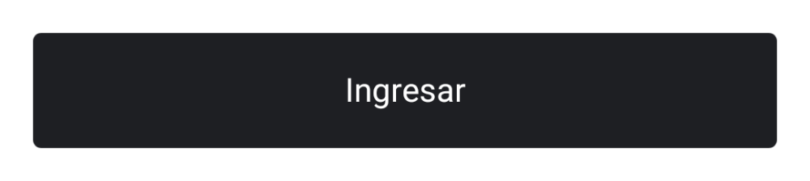

**`ButtonMF`**

```kotlin
ButtonMF(
    text = "Ingresar",
    onClick = { }
)
```

---

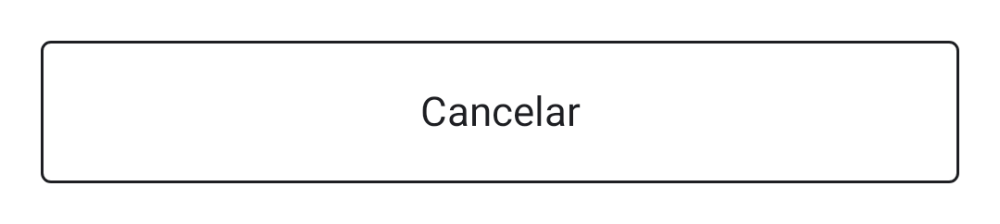

**`OutlinedButtonMF`**

```kotlin
OutlinedButtonMF(
    text = "Cancelar",
    onClick = { }
)
```

---

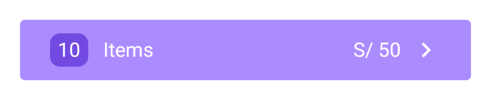

**`ButtonCountProduct`**

```kotlin
ButtonCountProduct(
    onClick = { },
    quantity = itemsSeleccionados,
    total = "S/ 50"
)
```


<sub>⚠️ El ícono derecho por defecto ya viene bundleado (<code>uikit_ic_arrow_right</code>) — pasa <code>icon</code> solo si quieres cambiarlo.</sub>

---

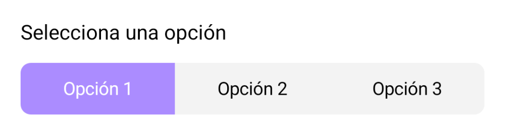

**`ToggleSelector2<T>`**

```kotlin
ToggleSelector2(
    label = "Selecciona una opción",
    options = opciones,
    selectedOption = seleccion,
    onOptionSelected = { seleccion = it },
    optionLabel = { it.nombre }
)
```

---

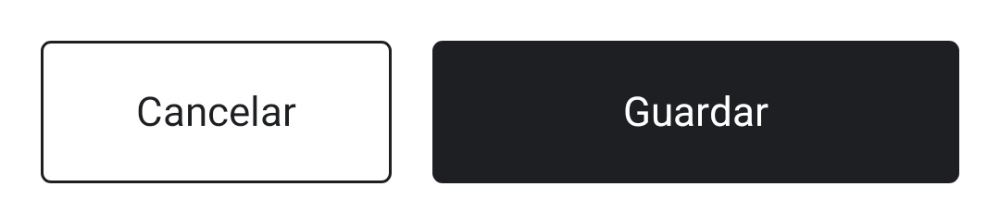

**`ButtonOptions`**

```kotlin
ButtonOptions(
    onClickCancel = { },
    onClickSave = { }
)
```


<sub>⚠️ Combina <code>OutlinedButtonMF</code> (cancelar) + <code>ButtonMF</code> (guardar) en una fila.</sub>


### Campos de texto (`ui.components.text_field`)


**`TextFieldMF`**

```kotlin
TextFieldMF(
    title = "Nombre",
    value = nombre,
    onChangeValue = { nombre = it }
)
```

---


Mismo componente con `showError = true` (usa el string bundleado
`uikit_field_required_error`, sobrescribible desde tu app).

---


**`SearchSection`**

```kotlin
SearchSection(
    modifier = Modifier.fillMaxWidth(),
    title = "Buscar producto",
    onSearch = { query -> },
    onClickIcon = { }       // o label = "Cerrar" en vez de icon
)
```

---


**`EditTextSearch`**

```kotlin
EditTextSearch(
    title = "Buscar…",
    onSearch = { query -> }
)
```

---


**`TextFieldPlate`**

```kotlin
TextFieldPlate(
    title = "Placa",
    value = placa,
    onChangeValue = { placa = it }
)
```


<sub>⚠️ Formatea a <code>ABC-123</code> automáticamente al tipear.</sub>

---


**`TextFieldWithButton`**

```kotlin
TextFieldWithButton(
    title = "Código",
    icon = painterResource(R.drawable.ic_barcode),
    onChangeValue = { },
    onClickIcon = { }       // ej. abrir el scanner
)
```

---


**`TextFieldDate`**

```kotlin
TextFieldDate(
    title = "Fecha de emisión",
    onChangeValue = { },
    icon = painterResource(R.drawable.ic_calendar),
    enabled = true
)
```

---


**`TextFieldDateTime`**

```kotlin
TextFieldDateTime(
    title = "Fecha y hora",
    onChangeValue = { },
    icon = painterResource(R.drawable.ic_calendar),
    enabled = true
)
```

---


**`TextFieldMonth`**

```kotlin
TextFieldMonth(
    title = "Mes y año",
    onChangeValue = { },
    icon = painterResource(R.drawable.ic_calendar),
    enabled = true
)
```

---


**`TextFieldWithCenteredImage`**

```kotlin
TextFieldWithCenteredImage(
    title = "Logo",
    imageUri = logoUri,     // null = muestra el placeholder
    onImageSelected = { uri -> }
)
```


<sub>⚠️ Usa <code>rememberLauncherForActivityResult</code> internamente — solo funciona con una <code>Activity</code>/<code>ComponentActivity</code> real detrás (cualquier pantalla normal de la app sirve).</sub>

---


**`SwitchMF`**

```kotlin
SwitchMF(
    text = "Notificaciones",
    value = habilitado,
    onCheckedChange = { habilitado = it }
)
```

---


**`FieldWidget`**

```kotlin
FieldWidget(
    title = "Cantidad",
    quantity = cantidad,
    onClickedMinus = { cantidad = it },
    onClickedPlus = { cantidad = it },
    onConfirmation = { cantidad = it }
)
```


<sub>⚠️ Combina <code>WidgetCounter</code> + <code>dialog/InputTextDialog</code> (ambos incluidos).</sub>

---


**`WidgetCounter`**

```kotlin
WidgetCounter(
    quantity = cantidad,
    stock = stockDisponible,
    stockControl = true,
    showInputDialog = { },
    onClickedMinus = { },
    onClickedPlus = { }
)
```


<sub>⚠️ Vive en <code>ui.components</code> (no en <code>text_field</code>) — es la piecita de <code>FieldWidget</code>, úsala suelta si no necesitas el diálogo de cantidad exacta.</sub>

---


**`FieldSearchNumDoc`**

```kotlin
FieldSearchNumDoc(
    title = "N° de documento",
    number = numero,
    requiredLength = 8,     // vos decides la longitud (DNI, RUC, etc.)
    onChangeValue = { numero = it },
    action = {
        IconButtonMF(text = "Buscar", onClick = { })
    }
)
```


<sub>⚠️ Rediseñado: el original de MypeFact traía DNI/RUC/SUNAT hardcodeados. Ahora vos armás la validación y el botón vía <code>action</code>.</sub>

---


**`TextFieldCountry`**

```kotlin
TextFieldCountry(
    title = "País",
    onValueChange = { country -> }
)
```


<sub>⚠️ Devuelve un <code>Country</code> de <code>country_code_picker/</code> (ver más abajo).</sub>

---


**`TextFieldPhoneNumberByCountry`**

```kotlin
TextFieldPhoneNumberByCountry(
    title = "Teléfono",
    onValueChange = { (codigo, numero, esValido) -> }
)
```


<sub>⚠️ <code>showError</code> por defecto es <code>true</code> (igual que el original) — pásale tu propia condición de validez.</sub>


### Selects (`ui.components.select`)


**`SelectMF<T>`**

```kotlin
SelectMF(
    title = "Categoría",
    options = categorias,
    selectedOption = seleccion?.nombre,
    onOptionSelected = { seleccion = it },
    optionLabel = { it.nombre }
)
```


<sub>⚠️ Con más de 5 <code>options</code> muestra buscador automáticamente.</sub>

---


**`SelectDialogMF`**

```kotlin
SelectDialogMF(
    title = "Serie",
    selectedOption = serie,
    onClick = { mostrarDialogo = true }
)
```


<sub>⚠️ Solo dibuja el campo — el diálogo de selección lo armas vos y lo abres en <code>onClick</code>.</sub>

---


**`SearchDropdownMenu<T>`**

```kotlin
SearchDropdownMenu(
    title = "Cliente",
    options = clientes,
    filter = { item, texto -> item.nombre.contains(texto, true) },
    optionLabel = { it.nombre },
    optionSelected = { cliente -> }
)
```


### Items (`ui.components.items`)


**`ItemEmptyList`**

```kotlin
ItemEmptyList()   // o ItemEmptyList("Sin resultados")
```

---

<br>


**`RadioButtonWithBorder`**

```kotlin
RadioButtonWithBorder(
    isSelected = seleccion == opcion,
    onClick = { seleccion = opcion },
    label = opcion.nombre
)
```


### Selector de país / teléfono (`ui.components.country_code_picker`)

Subsistema completo de 10 archivos (enum `Country` con ~240 países, validación y formato de números vía `libphonenumber-android`, bottom sheet y diálogo de selección). Ya era genérico en el original — se migró completo y sin cambios de API.


**`CountryCodePicker`**

```kotlin
CountryCodePicker(
    selectedCountry = Country.Peru,
    onCountrySelected = { country -> }
)
```


<sub>⚠️ Normalmente no lo usas directo — <code>TextFieldPhoneNumberByCountry</code> ya lo trae integrado como <code>leadingIcon</code>.</sub>


La dependencia `io.michaelrocks:libphonenumber-android` va como `implementation` dentro de la librería — no hace falta declararla en tu app, ya viaja incluida.

### Alertas y diálogos (`ui.components.alerts`, `ui.components.dialog`)


**`LoaderDialog`**

```kotlin
LoaderDialog(text = "Cargando…")
```


<sub>⚠️ El ícono gira infinitamente. Trae un ícono de carga bundleado por defecto.</sub>

---

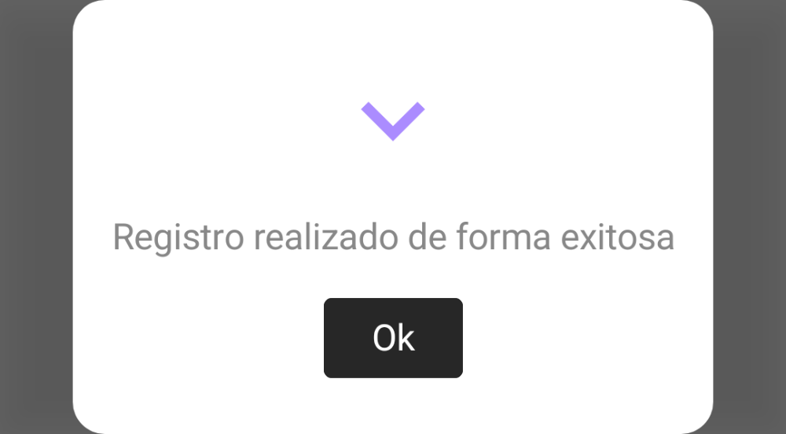

**`AlertDialog`**

```kotlin
AlertDialog(
    description = "Registro realizado con éxito",
    image = painterResource(R.drawable.ic_success),
    onDismissRequest = { },
    onConfirmation = { },
    showConfirmationButton = true,
    buttonSave = "Ok"
)
```


<sub>⚠️ <code>image</code> es obligatorio (antes se llamaba <code>imageResourceId</code>); el ícono opcional del botón se renombró a <code>buttonIcon</code> para no confundirlos.</sub>

---

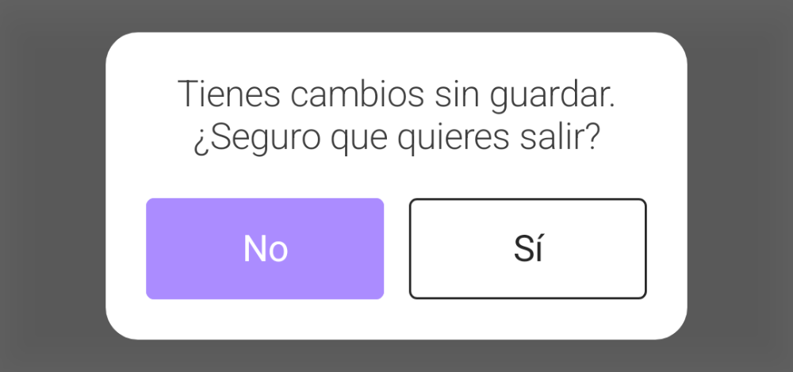

**`WarningDialog`**

```kotlin
WarningDialog(
    description = "¿Seguro que quieres salir sin guardar?",
    onDismissRequest = { },
    onConfirmation = { }
)
```


<sub>⚠️ Es el diálogo de confirmación que usa <code>ToolBarMF</code> internamente cuando <code>onShowDialog = true</code>.</sub>

---

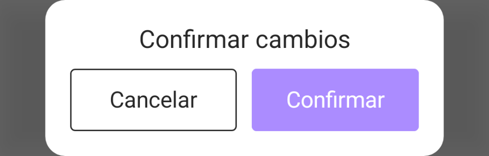

**`ConfirmDialog`**

```kotlin
ConfirmDialog(
    title = "Confirmar cambios",
    onDismissRequest = { },
    onConfirmation = { motivo -> }
)
```


<sub>⚠️ Con <code>showTextField = true</code> agrega un <code>TextFieldMF</code> y el motivo llega en <code>onConfirmation</code>.</sub>

---

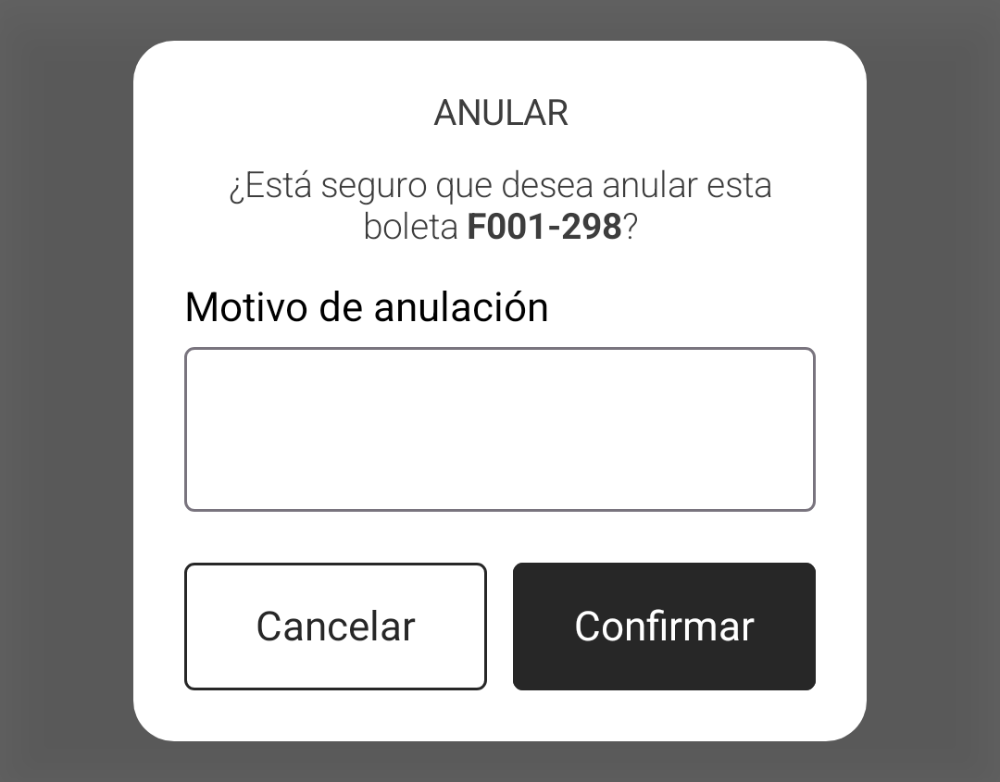

**`NullDialog`**

```kotlin
NullDialog(
    title = "ANULAR",
    billNumber = "F001-298",
    onDismissRequest = { },
    onConfirmation = { motivo -> }
)
```


<sub>⚠️ Pensado específicamente para anular/nulificar un comprobante (no es un confirm genérico como <code>ConfirmDialog</code>).</sub>


### Toolbar (`ui.components.toolbar`)

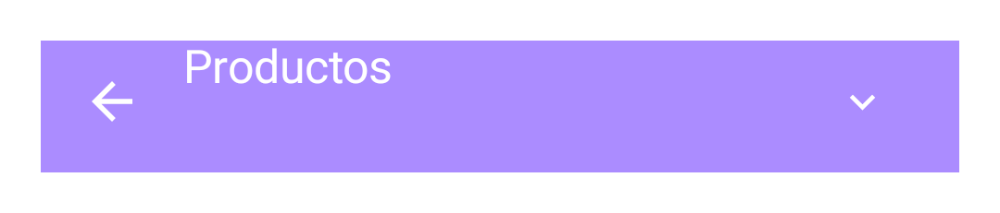

**`ToolBarMF`**

```kotlin
ToolBarMF(
    title = "Productos",
    onReturnScreen = { navController.popBackStack() }
)
```


<sub>⚠️ Con <code>onShowDialog = true</code> muestra un <code>WarningDialog</code> de confirmación antes de salir (back físico incluido, vía <code>BackHandler</code>). <code>icon</code>/<code>onClickIcon</code> agregan una acción a la derecha.</sub>

---

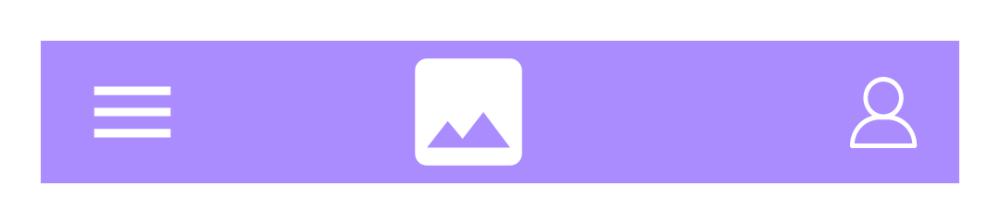

**`AppTopBar`**

```kotlin
AppTopBar(
    logo = painterResource(R.drawable.mi_logo),
    menuItems = listOf(
        AppTopBarMenuItem(
            id = "catalog",
            label = "Catálogo",
            icon = painterResource(R.drawable.ic_catalog),
            onClick = { /* navegar */ }
        ),
        AppTopBarMenuItem(
            id = "settings",
            label = "Configuración",
            icon = painterResource(R.drawable.ic_settings),
            onClick = { /* navegar */ }
        )
    ),
    bottomMenuItems = listOf(
        AppTopBarMenuItem(
            id = "logout",
            label = "Cerrar sesión",
            icon = painterResource(R.drawable.ic_logout),
            color = Color.Red,
            onClick = { showLogoutConfirm = true }
        )
    ),
    dropdownHeight = 400.dp,   // opcional — sin esto bottomMenuItems no queda pegado abajo
    onProfileClick = { showProfile = true }
)
```


<sub>⚠️ Reemplaza a <code>ToolBarHome</code>, el único componente con <code>hiltViewModel()</code> + <code>NavHostController</code> + <code>Activity</code>s propias incrustadas directo en el original. Acá cada <code>AppTopBarMenuItem</code> trae su propio <code>onClick</code> — la navegación, el chequeo de Bluetooth, el logout, etc. los arma tu app al construir la lista. Para el diálogo de "¿cerrar sesión?" no hace falta un componente nuevo — usa <code>WarningDialog(description = "¿Seguro que quieres cerrar sesión?", ...)</code>. Para el popup de perfil, ver <code>ProfileDialog</code> abajo.</sub>

---

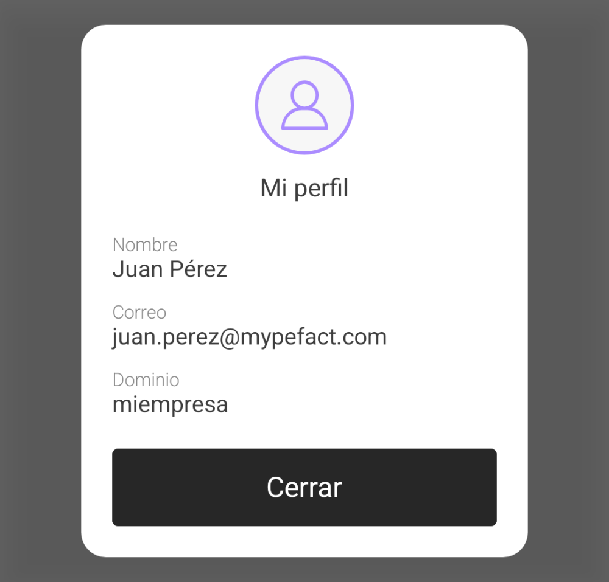

**`ProfileDialog`**

```kotlin
ProfileDialog(
    name = usuario.nombre,
    email = usuario.email,
    domain = usuario.subdominio,
    logoUri = miLogoUri,   // null = ícono de usuario por defecto
    onDismissRequest = { showProfile = false }
)
```


<sub>⚠️ El original leía el logo desde una ruta fija (<code>Constants.IMAGE_PATH</code>); acá tu app pasa su propio <code>logoUri</code>. Vive en <code>ui.components.dialog</code>, no en <code>toolbar</code> — normalmente se abre desde el <code>onProfileClick</code> de <code>AppTopBar</code>.</sub>

### Restaurante (`ui.components`, `ui.components.dialog`, `ui.components.items`)

Estos son los componentes atados a datos que se dejaron para el final
(Wave 3). Ya no dependen de `ProductEntity`/`WarehouseEntity` ni de ningún
ViewModel — ver el modelo genérico [`UiKitProduct` / `UiKitComment`](#modelo-de-datos-genérico-uikitproduct--uikitcomment)
más abajo.

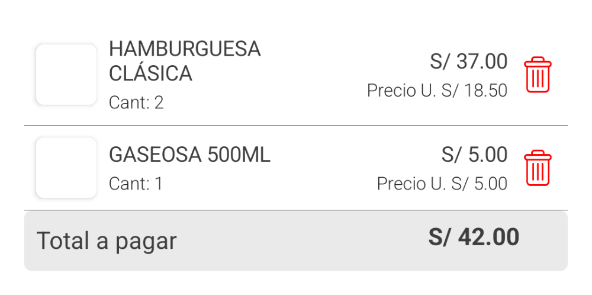

**`TableProductList`**

```kotlin
TableProductList(
    items = productos, // List<UiKitProduct>
    onClickDelete = { index -> }
)
```


<sub>⚠️ Lista + footer con el total. Borra por índice (así era el original) — para borrar por id real, usa la versión de restaurante.</sub>

---

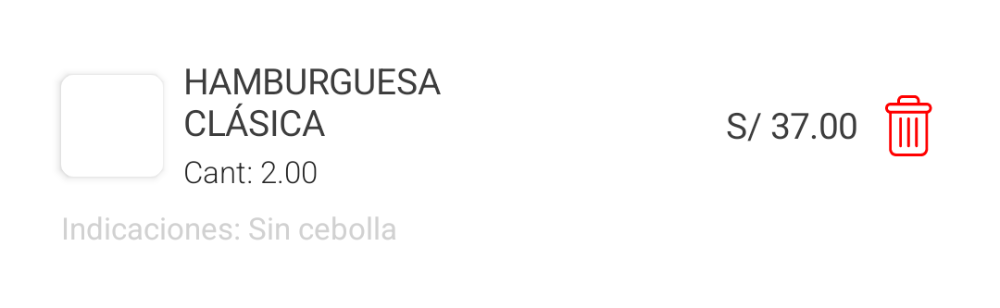

**`ItemProductRestaurantList`**

```kotlin
ItemProductRestaurantList(
    item = producto,
    comments = indicaciones, // List<UiKitComment>
    onClickDelete = { id, commentIndex -> }
)
```

---

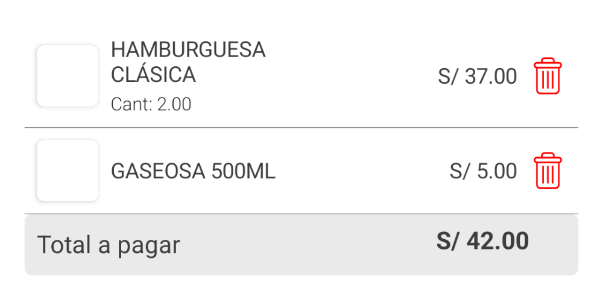

**`TableRestaurantProductList`**

```kotlin
TableRestaurantProductList(
    items = productos,
    onClickDelete = { id, commentIndex -> }
)
```


<sub>⚠️ Expande automáticamente productos con cantidad &gt; 1 en unidades individuales cuando tienen indicaciones distintas (usa <code>RestaurantListUtils.expandProductsWithComments</code>).</sub>

---

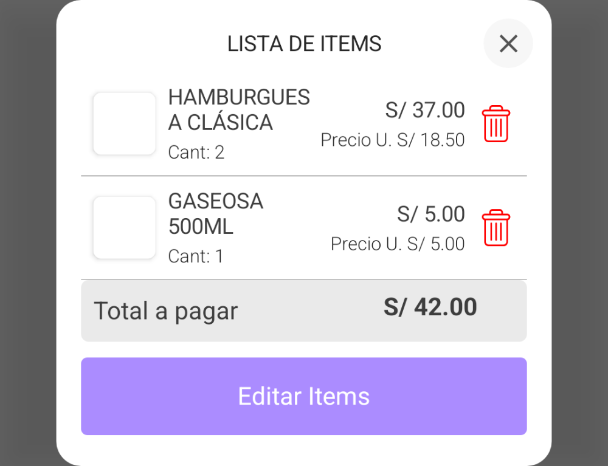

**`TableDialog`**

```kotlin
TableDialog(
    items = productos,
    onClickButton = { /* ir a editar */ },
    onDismissRequest = { },
    onClickDelete = { index -> }
)
```

---

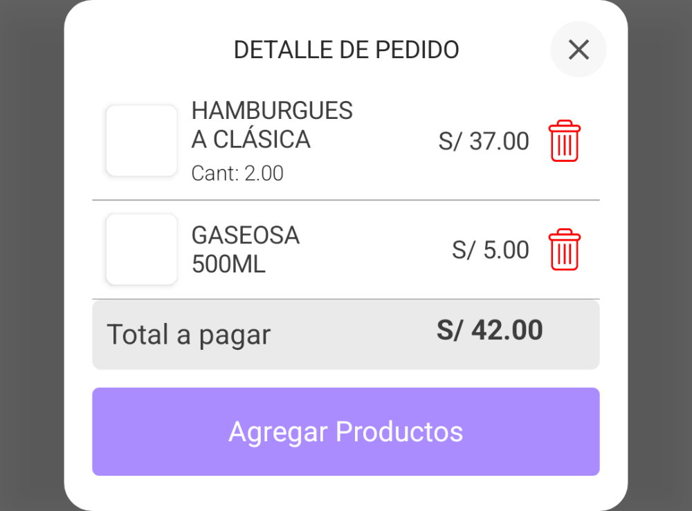

**`TableRestaurantDialog`**

```kotlin
TableRestaurantDialog(
    items = productos,
    onClickButton = { /* agregar más productos */ },
    onDismissRequest = { },
    onClickDelete = { id, commentIndex -> }
)
```

---

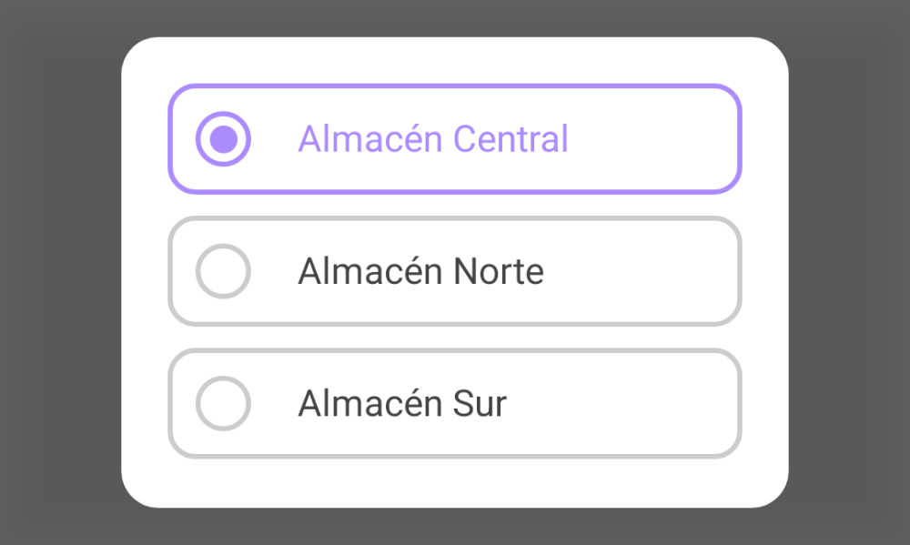

**`FilterDialogMF<T>`**

```kotlin
FilterDialogMF(
    options = almacenes,
    selectedOption = seleccionado,
    setLabel = { it.nombre },
    onClick = { seleccionado = it }
)
```


<sub>⚠️ Ya era 100% genérico en el original — se migró sin cambios de API.</sub>

---

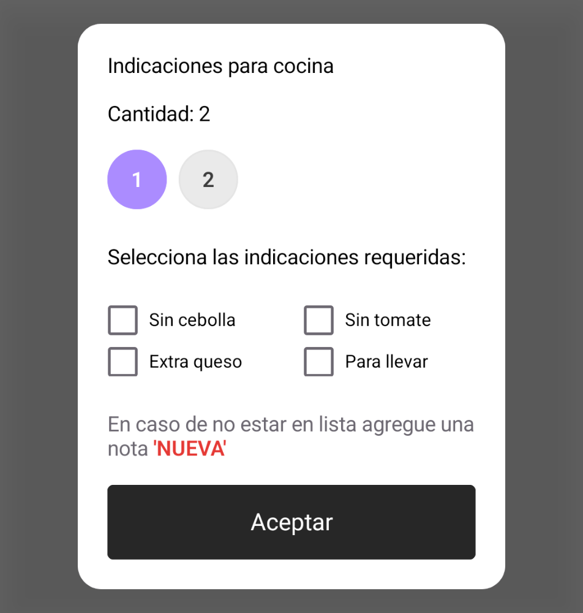

**`DialogInputComment`**

```kotlin
DialogInputComment(
    product = producto,
    quantity = 2,
    category = "Hamburguesas",
    availableComments = indicacionesDisponibles,
    onDismissRequest = { },
    onRequestNewComment = { categoria, texto -> /* guardar y refrescar */ },
    onConfirm = { producto, gruposDeComentarios -> /* persistir */ }
)
```


<sub>⚠️ El más rediseñado del kit: el original recibía un <code>BaseViewModel</code> completo y observaba 4 LiveData. Acá todo el estado de red (comentarios disponibles, guardar uno nuevo) se recibe por parámetro/callback; el estado de tabs/selección sigue siendo interno porque es pura interacción de UI.</sub>


#### Modelo de datos genérico: `UiKitProduct` / `UiKitComment`

Reemplaza a `ProductEntity` (Room), `RestaurantNote`/`RestaurantNoteResponse`
y `ProductCommentGroup` del proyecto original. Tu app mapea su propia
entidad a esto antes de pasarlo a cualquier componente de esta sección —
ahí es donde va la lógica específica de tu proyecto (ej. cómo armar el
texto de presentación, qué usar como id cuando el producto es local/offline).

```kotlin
data class UiKitProduct(
    val id: String,               // antes: if (id == 0) internalId else id.toString()
    val itemTypeId: String,       // antes: itemId — clave para agrupar unidades del mismo producto
    val description: String,      // ya resuelto, incluye cualquier sufijo de presentación
    val quantity: BigDecimal,      // antes: auxQuantity (String)
    val unitPrice: BigDecimal,     // antes: saleUnitPrice (String)
    val imageUrl: String? = null,
    val commentGroups: List<UiKitCommentGroup> = emptyList() // antes: JSON en `comment`
)

data class UiKitComment(
    val id: Int,
    val description: String,
    val categoryId: Int,
    val isSelected: Boolean = false
)

data class UiKitCommentGroup(
    val itemIndex: Int,
    val comments: List<UiKitComment> = emptyList()
)
```

Ejemplo de mapeo desde una entidad Room propia:

```kotlin
fun MyProductEntity.toUiKitProduct() = UiKitProduct(
    id = if (id == 0) internalId else id.toString(),
    itemTypeId = itemId.toString(),
    description = description ?: "",
    quantity = auxQuantity.toBigDecimal(),
    unitPrice = saleUnitPrice.toBigDecimal(),
    imageUrl = image,
    commentGroups = comment?.let { json.decodeFromString(it) } ?: emptyList()
)
```

### Facturación de restaurante (`ui.components`, `ui.components.card`, `ui.components.items`, `ui.components.dialog`, `ui.components.alerts`)

El flujo real de MypeFact es: mesa/take away → `TableManagementViewModel.generatePayment()`
→ pantallas "genéricas" de facturación (`GenericCreateScreen`,
`GenericSearchProductScreen`, `GenericSearchClientScreen`,
`GenericAddProductScreen`). Estos componentes son los que ese flujo usa
para armar y cobrar el documento — reemplazan `ProductEntity`,
`ItemTypesEntity`, `ItemLotsEntity`/`LotsGroupEntity`,
`PaymentMethodEntity`/`PaymentDestinationsEntity` y los `UiState` que los
envolvían (`ItemProductsUiState`, `ListPriceDialogUiState`,
`DataPaymentMethodUiState`, `LoaderUiState`) por modelos genéricos — ver
[Modelos de facturación](#modelos-de-facturación) más abajo.

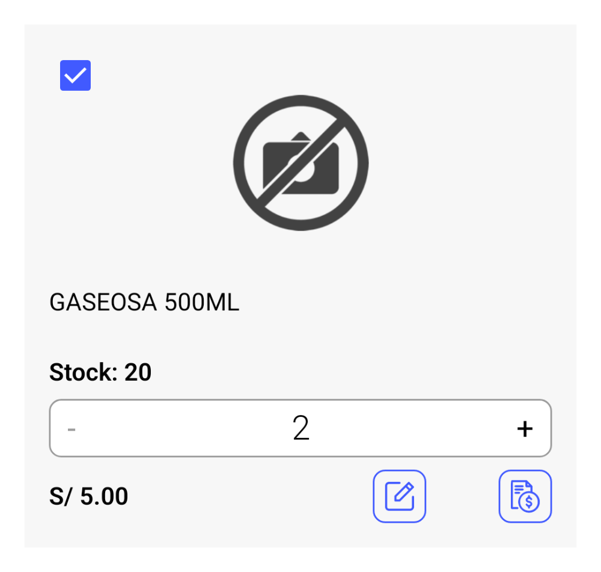

**`ItemProduct`**

```kotlin
ItemProduct(
    product = producto, // UiKitCatalogProduct
    currentCost = precioActual,
    isChecked = seleccionado,
    quantity = cantidad,
    stockControl = true,
    isEditPriceEnabled = true,
    showInputDialog = { },
    showListPrice = { id -> },
    showCommentDialog = { producto, categoria -> },
    showPriceDialog = { },
    showQuantityByPrice = { },
    showItemLotsDialog = { },
    onCheckedChange = { },
    onClickedMinus = { },
    onClickedPlus = { }
)
```


<sub>⚠️ Card de un producto de catálogo/grilla de selección (distinto de <code>ItemProductList</code>, que muestra una línea ya agregada). Los 4 íconos del footer (editar, comentario, granel, precio por lista) son decorativos y vienen bundleados — no son parámetro, igual que en el original.</sub>

---

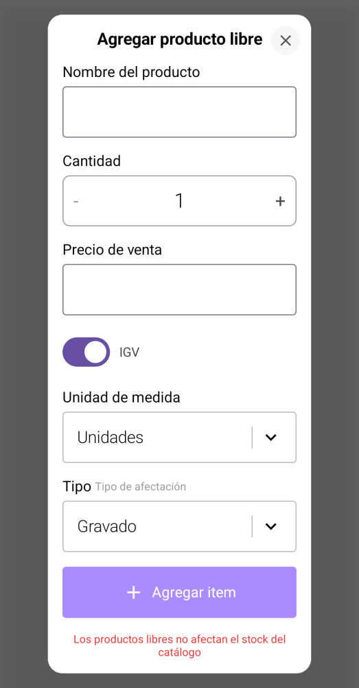

**`DialogFormFreeProduct`**

```kotlin
DialogFormFreeProduct(
    show = mostrar,
    unitOptions = unidadesDeMedida,       // List<UiKitOption>
    affectationOptions = tiposAfectacion, // List<UiKitOption>
    defaultAffectationId = "10",
    onAddProduct = { resultado -> /* mapear a tu propia entidad */ },
    onDismissRequest = { }
)
```


<sub>⚠️ Antes construía un <code>ProductEntity</code> completo internamente (moneda fija, prefijo de id, etc.); ahora devuelve un <code>FreeProductFormResult</code> con lo que el usuario ingresó, y tu app arma su propia entidad con eso.</sub>

---

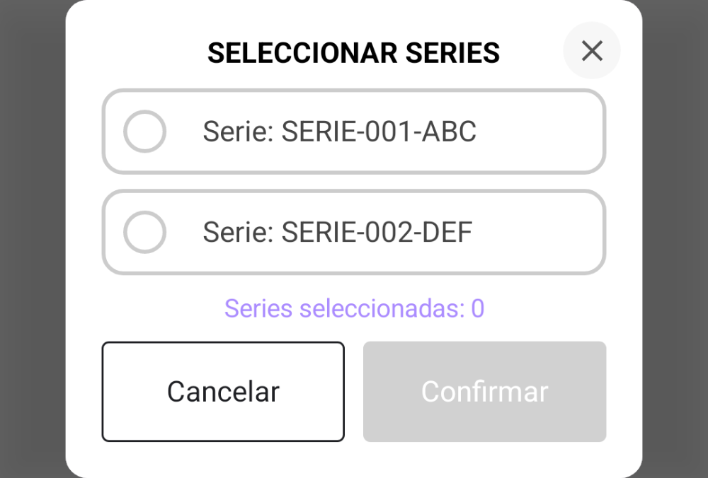<br>
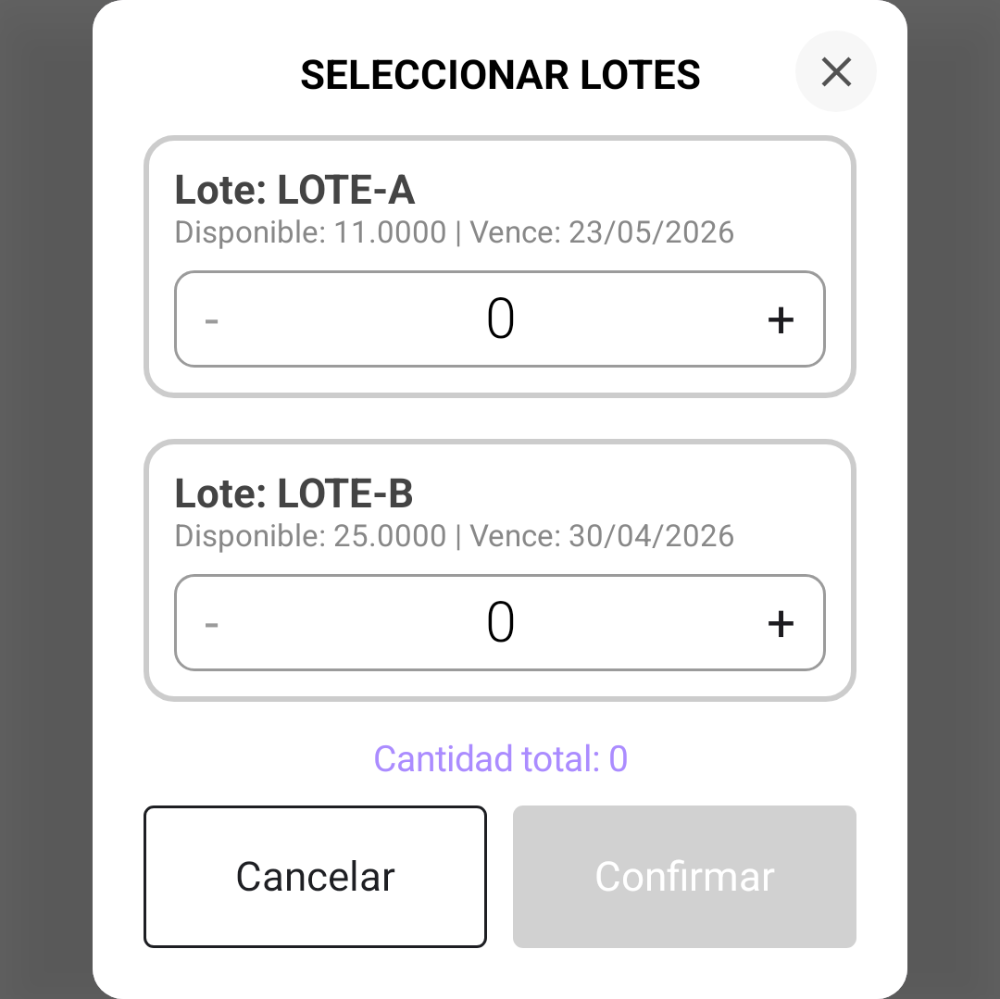<br>
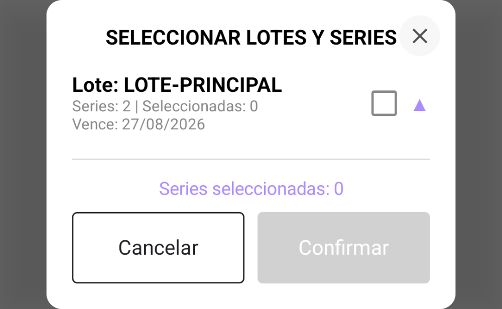

**`DialogItemLots`**

```kotlin
DialogItemLots(
    show = mostrar,
    selectionType = LotsSelectionType.LOTS_WITH_SERIES,
    itemLots = series,           // List<UiKitSeries>
    lotsGroup = lotes,           // List<UiKitLotGroup>
    lotsWithSeries = lotesConSeries, // List<LotWithSeries>
    onConfirmation = { resultado -> /* LotsSelectionResult */ },
    onDismissRequest = { }
)
```


<sub>⚠️ 3 modos según cómo el producto rastrea su stock: solo series, solo lotes, o lotes con series anidadas. A diferencia del original (que recibía y devolvía un <code>ItemProductsUiState</code> completo), acá solo maneja la selección — tu app ya sabe para qué producto abrió el diálogo.</sub>

---

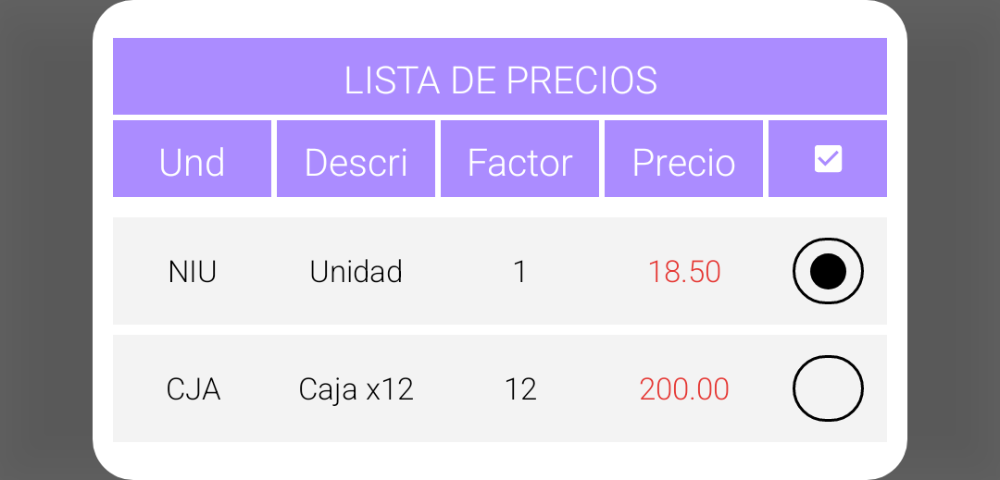

**`ListPriceDialog`**

```kotlin
ListPriceDialog(
    show = mostrar,
    options = presentaciones, // List<UiKitPriceOption>
    originalPrice = precioOriginal,
    originalUnitType = "NIU",
    currentPrice = precioActual,
    onSelectItem = { seleccion -> /* SelectedPriceParam */ },
    onDismissRequest = { }
)
```


<sub>⚠️ El original elegía entre <code>price1</code>/<code>price2</code>/<code>price3</code> según un <code>priceDefault</code>; acá cada <code>UiKitPriceOption</code> ya trae un único <code>price</code> resuelto — esa selección la hace tu app al mapear.</sub>

---

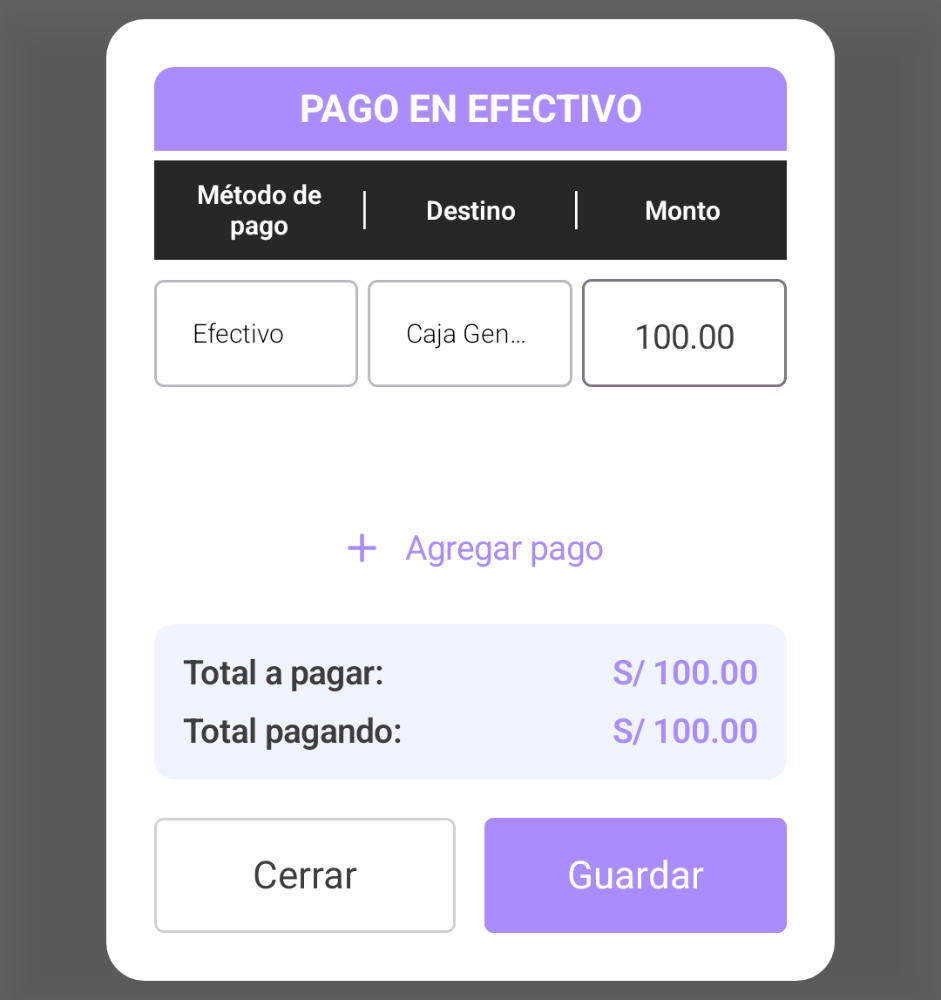

**`PaymentCashDialog`**

```kotlin
PaymentCashDialog(
    title = "PAGO EN EFECTIVO",
    listPayment = metodosDePago,       // List<UiKitPaymentMethod>
    listDestination = destinos,        // List<UiKitPaymentDestination>
    currentPaymentMethod = null,
    currentPaymentDestinations = null,
    total = totalDelDocumento,
    methodLabel = "Efectivo",
    saveCashPayment = { pagos, etiqueta -> },
    onDismissRequest = { },
    onConfirmation = { }
)
```


<sub>⚠️ Reparte el total automáticamente entre las filas de pago que agregues. El original filtraba destinos según si el método era "Transferencia" (lógica de negocio específica) — eso se quitó; tu app filtra <code>listDestination</code> antes de pasarla si lo necesita.</sub>

---

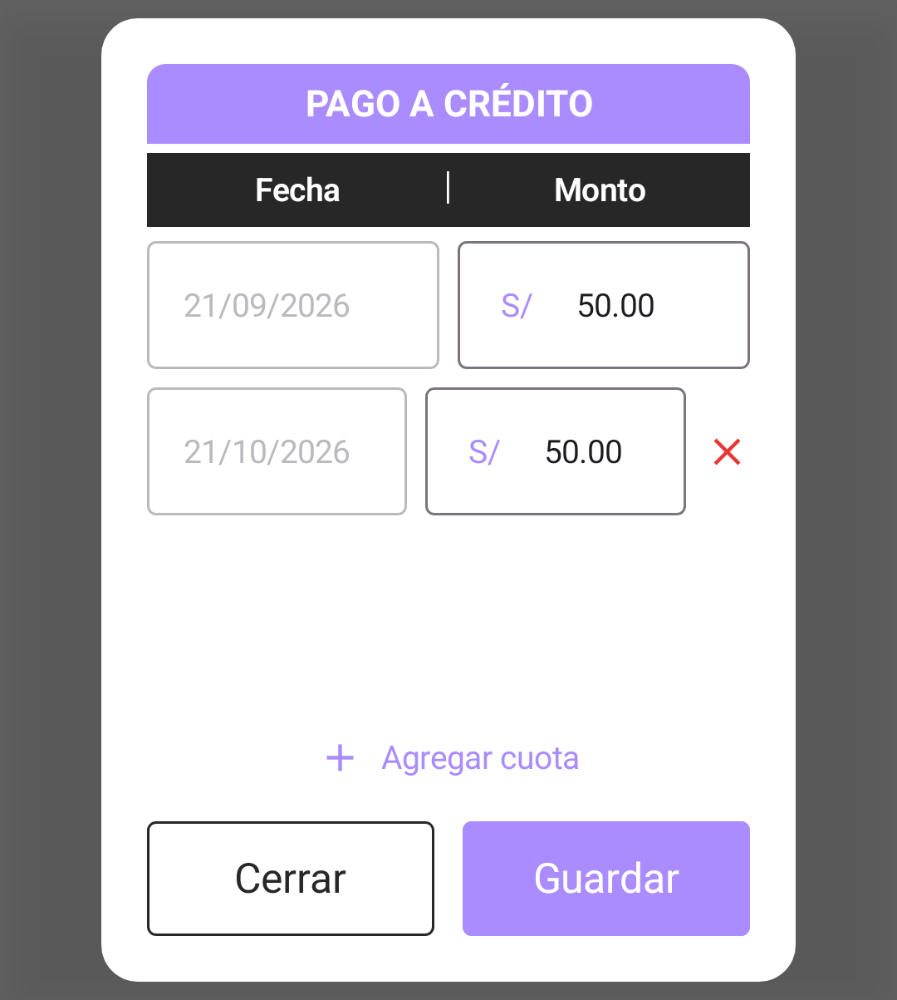

**`PaymentInstallmentsDialog`**

```kotlin
PaymentInstallmentsDialog(
    title = "PAGO A CRÉDITO",
    total = totalDelDocumento,
    methodLabel = "Crédito",
    saveInstallmentsPayment = { cuotas, etiqueta -> },
    onDismissRequest = { },
    onConfirmation = { }
)
```


<sub>⚠️ Reparte el total entre cuotas automáticamente; cada cuota nueva sugiere la fecha del mes siguiente. <code>dateFormatPattern</code> (default <code>dd/MM/yyyy</code>) es configurable si tu app usa otro formato.</sub>

---

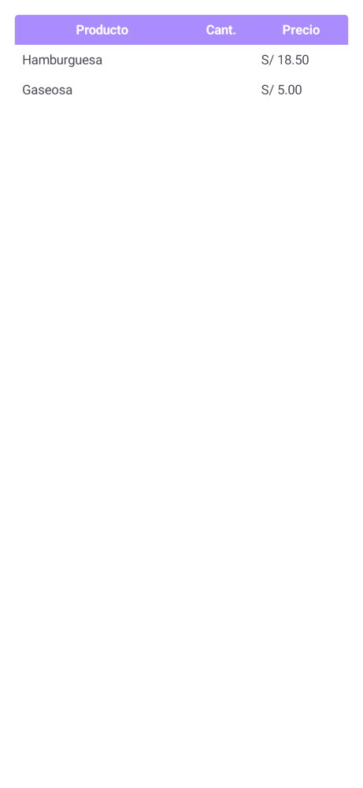

**`CustomTable<T>`**

```kotlin
CustomTable(
    headers = listOf("Producto", "Cant.", "Precio"),
    weights = listOf(2f, 1f, 1f),
    items = filas,
    rowContent = { fila -> /* tu Row */ }
)
```

---


**`OutlineIconButtonMF`**

```kotlin
OutlineIconButtonMF(
    icon = painterResource(R.drawable.mi_icono),
    onClick = { }
)
```

---

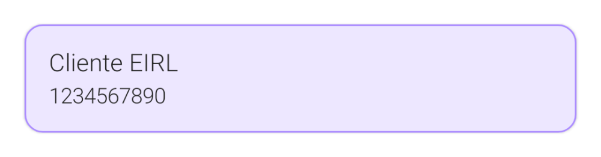

**`SelectableCard`**

```kotlin
SelectableCard(
    title = cliente.nombre,
    subTitle = cliente.documento,
    isSelected = seleccionado == cliente,
    onClick = { seleccionado = cliente }
)
```

---

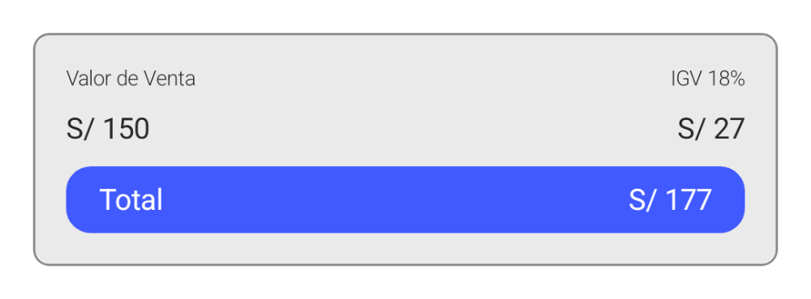

**`CardPriceMultiple`**

```kotlin
CardPriceMultiple(
    titles = listOf("Valor de Venta" to "IGV 18%"),
    subtitles = listOf("S/ 150" to "S/ 27"),
    total = "S/ 177"
)
```

---

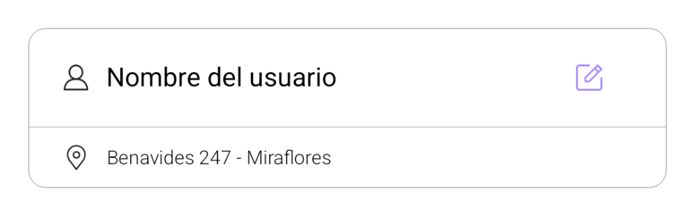

**`DataClient`**

```kotlin
DataClient(
    userName = cliente.nombre,
    userAddress = cliente.direccion,
    onUserChange = { },
    onAddressChange = { direccion -> },
    onEditUser = { /* abrir buscador de cliente */ }
)
```

---

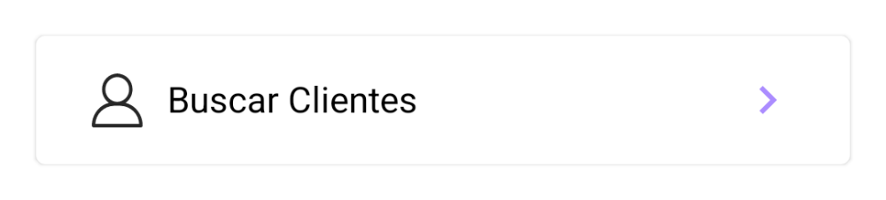

**`SearchButton`**

```kotlin
SearchButton(
    textButton = "Buscar Clientes",
    onClick = { }
)
```

---

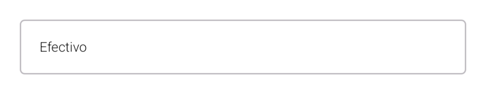

**`SelectSmallMF<T>`**

```kotlin
SelectSmallMF(
    options = metodosDePago,
    selectedOption = seleccion?.description,
    onOptionSelected = { seleccion = it },
    optionLabel = { it.description }
)
```


<sub>⚠️ Versión compacta de <code>SelectMF</code> sin título ni buscador — la usan las filas de <code>PaymentCashDialog</code>.</sub>

---


**`LoaderProgressDialog`**

```kotlin
LoaderProgressDialog(
    isVisible = subiendo,
    progress = progreso, // 0f..1f
    description = "Subiendo imagen..."
)
```


<sub>⚠️ El original recibía un <code>LoaderUiState</code> completo; acá los 3 campos van directo por parámetro.</sub>

---

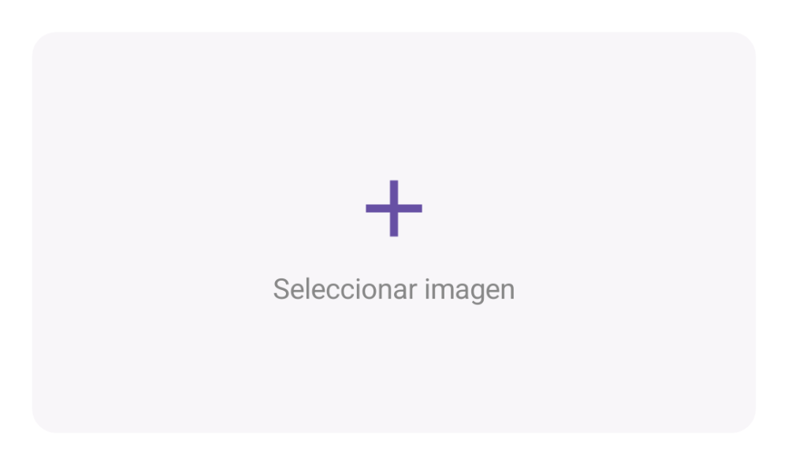

**`ImagePickerComponent`**

```kotlin
ImagePickerComponent(
    currentImageUrl = producto.imagen,
    onImageSelected = { archivoOptimizado -> }
)
```


<sub>⚠️ Optimiza la foto (resize + orientación EXIF) antes de devolverla. Para tomar foto con cámara tu app necesita declarar su propio <code>FileProvider</code> en el manifest — ver el KDoc del componente. <code>fileProviderAuthority</code> es opcional si no usas la convención <code>"{packageName}.fileprovider"</code>.</sub>


#### Modelos de facturación

```kotlin
// Reemplaza ItemTypesEntity (ListPriceDialog) — el precio ya llega resuelto,
// no los 3 price1/2/3 + priceDefault del original.
data class UiKitPriceOption(
    val id: String,
    val unitTypeId: String,
    val description: String,
    val quantityUnit: String,
    val price: BigDecimal
)

// Reemplazan ItemLotsEntity / LotsGroupEntity (DialogItemLots).
data class UiKitSeries(val id: Int, val series: String, val date: String)
data class UiKitLotGroup(
    val id: Int,
    val code: String,
    val quantity: BigDecimal,
    val dateOfDue: String,
    val selectedQuantity: Int = 0 // antes: auxQuantity: String?
)

// Reemplazan PaymentMethodEntity / PaymentDestinationsEntity / CashState / QuotasState.
data class UiKitPaymentMethod(val id: String, val description: String)
data class UiKitPaymentDestination(val id: String, val description: String)
data class UiKitCashPayment(
    val payment: UiKitPaymentMethod? = null,
    val destination: UiKitPaymentDestination? = null,
    val payWith: String? = null
)
data class UiKitInstallment(val date: String? = null, val amount: String? = null)

// Reemplaza ProductEntity para ItemProduct (grilla de catálogo — distinto
// de UiKitProduct, que es una línea ya agregada a un documento).
data class UiKitCatalogProduct(
    val id: String,
    val description: String,
    val imageUrl: String? = null,
    val stock: BigDecimal = BigDecimal.ZERO,
    val currencySymbol: String = "S/",
    val category: String? = null,
    val calculateQuantity: Boolean = false
)

// Opción simple id/descripción para selects genéricos (unidades de medida,
// tipos de afectación IGV) donde no vale la pena un modelo dedicado.
data class UiKitOption(val id: String, val description: String)
```

### Cards y reportes (`ui.components.card`, `ui.components.items`, `ui.components`)

Resto de uso general (Wave 4b) — no atados a restaurante ni facturación.

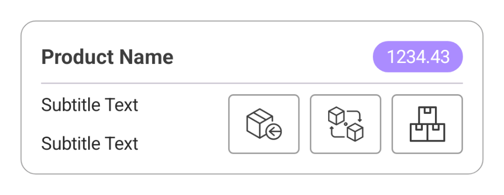

**`CardInventory`**

```kotlin
CardInventory(
    title = producto.nombre,
    stock = producto.stock.toString(),
    subtitleText = "Ingreso - Salida",
    onInputInventory = { },
    onMoveInventory = { },
    onAdjustmentInventory = { }
)
```

---

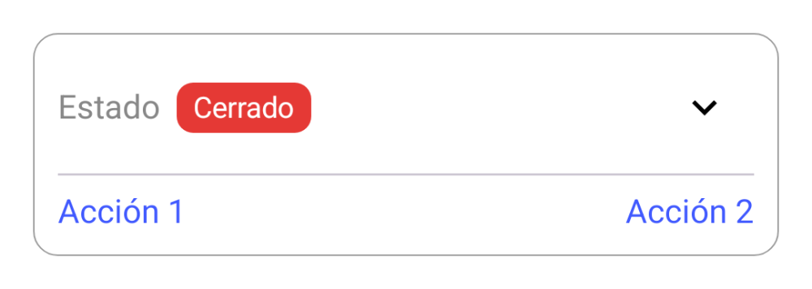

**`CardList`** (+ `InfoRow`)

```kotlin
CardList(
    badgeColor = Color.Red,
    badgeText = "Cerrado",
    headerText = "Estado",
    footerLeftText = "Acción 1",
    footerRightText = "Acción 2",
    onFooterLeftClick = { },
    onFooterRightClick = { }
) {
    Column {
        InfoRow(leftText = "Abrió caja", rightText = "Julio Martínez")
        InfoRow(leftText = "Fecha", rightText = "12/12/2021")
    }
}
```

---

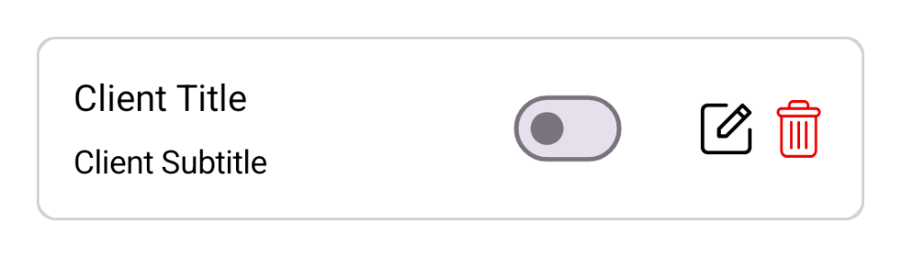

**`CardListClient`**

```kotlin
CardListClient(
    title = cliente.nombre,
    subtitle = cliente.documento,
    checked = cliente.activo,
    onCheckedChange = { },
    editIcon = painterResource(R.drawable.ic_edit),
    deleteIcon = painterResource(R.drawable.ic_delete),
    onEditClick = { },
    onDeleteClick = { }
)
```

---

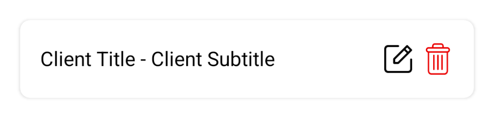

**`CardListSimple`**

```kotlin
CardListSimple(
    title = item.nombre,
    subtitle = item.detalle,
    editIcon = painterResource(R.drawable.ic_edit),
    deleteIcon = painterResource(R.drawable.ic_delete)
)
```


<sub>⚠️ Con <code>options = false</code>, en vez de los íconos muestra <code>trailingText</code> (ej. "Disponible: 10.00") — antes era un <code>number: Double</code> con un string de negocio bundleado.</sub>

---

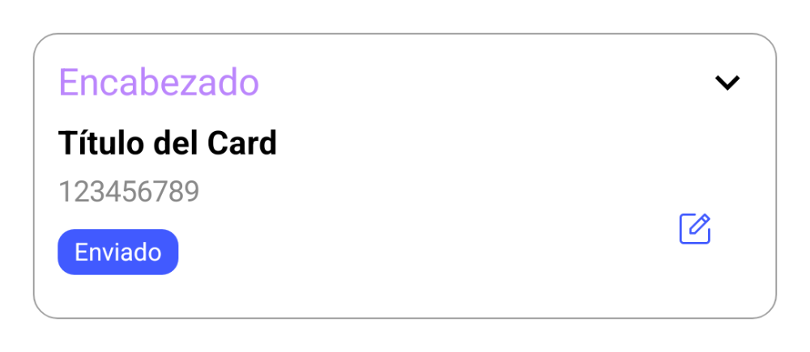

**`CardDetails`**

```kotlin
CardDetails(
    headerText = "F001-123",
    titleText = documento.cliente,
    subtitleText = documento.numero,
    badgeText = "Enviado",
    calendarIcon = painterResource(R.drawable.ic_calendar),
    dateTimeText = documento.fecha,
    additionalSubtitle = documento.detalle,
    actions = listOf(
        CardDetailsAction("print", painterResource(R.drawable.ic_print), showWhenCollapsed = true, onClick = { }),
        CardDetailsAction("whatsapp", painterResource(R.drawable.ic_wsp), onClick = { /* tu propio diálogo */ })
    )
)
```


<sub>⚠️ El más rediseñado de este grupo: el original filtraba qué acciones mostrar comparando el <code>R.drawable</code> exacto contra 3 flags de negocio (<code>isAccept</code>/<code>isRegistered</code>/<code>isEnabledDispatch</code>), y abría un diálogo de WhatsApp propio al detectar ese ícono. Ahora cada <code>CardDetailsAction</code> ya viene resuelta por la app — <code>showWhenCollapsed</code> decide si aparece en la fila visible con la card cerrada o solo al expandir.</sub>

---

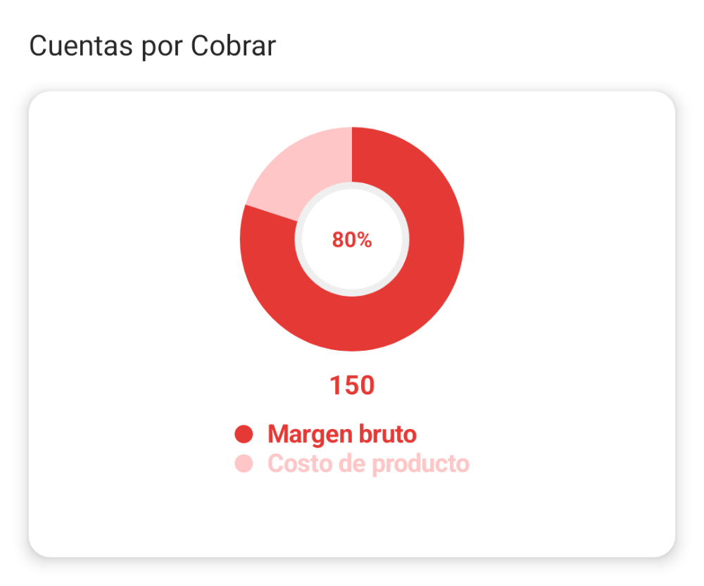

**`ItemCircleReport`**

```kotlin
ItemCircleReport(
    item = UiKitCircleReportItem(
        title = "Cuentas por Cobrar",
        percentage = BigDecimal(80),
        primaryText = "Margen bruto",
        primaryColor = Color(0xFFE53935),
        secondaryText = "Costo de producto",
        secondaryColor = Color(0xFFFEC6C6),
        number = "150"
    )
)
```

---

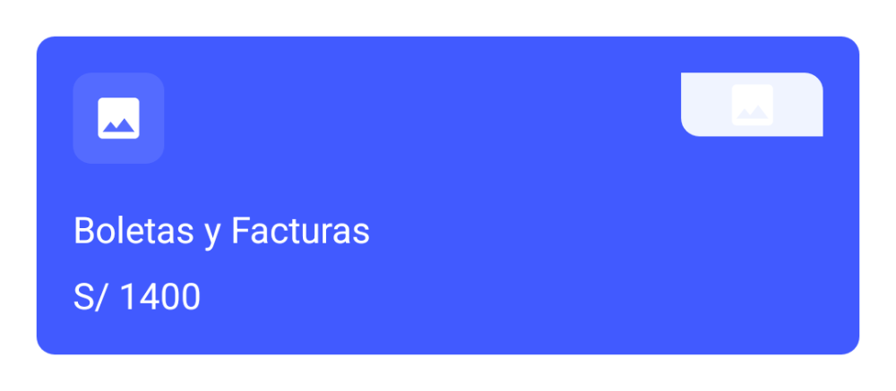

**`ItemReportDashboard`**

```kotlin
ItemReportDashboard(
    UiKitDashboardCard(
        icon = painterResource(R.drawable.ic_bill),
        trailingIcon = painterResource(R.drawable.logo_sunat), // opcional
        title = "Boletas y Facturas",
        value = "S/ 1400"
    )
)
```

---

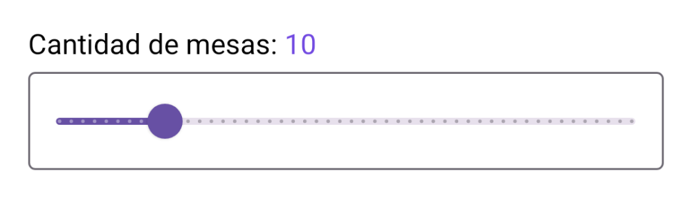

**`CountSlider`**

```kotlin
CountSlider(
    label = "Cantidad de mesas:",
    value = cantidad,
    valueRange = 1..50,
    onValueChange = { cantidad = it }
)
```

---

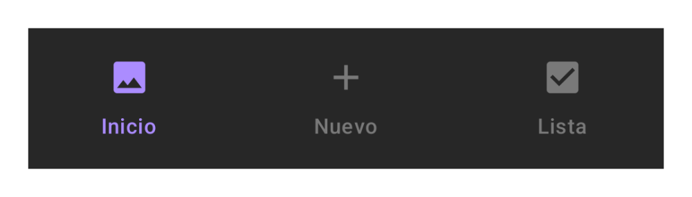

**`NavigationBottomBar`**

```kotlin
NavigationBottomBar(
    items = listOf(
        UiKitNavItem("home", "Inicio", painterResource(R.drawable.ic_home)),
        UiKitNavItem("new", "Nuevo", painterResource(R.drawable.ic_new)),
        UiKitNavItem("list", "Lista", painterResource(R.drawable.ic_list))
    ),
    selectedRoute = rutaActual,
    onItemClick = { item -> navController.navigate(item.route) }
)
```


<sub>⚠️ El original traía 5 pantallas de MypeFact hardcodeadas en un sealed class (<code>NavigationBottomBarRouter</code>) leído de <code>Utils.navigationItems</code> — acá tu app arma su propia lista de <code>UiKitNavItem</code>.</sub>

---

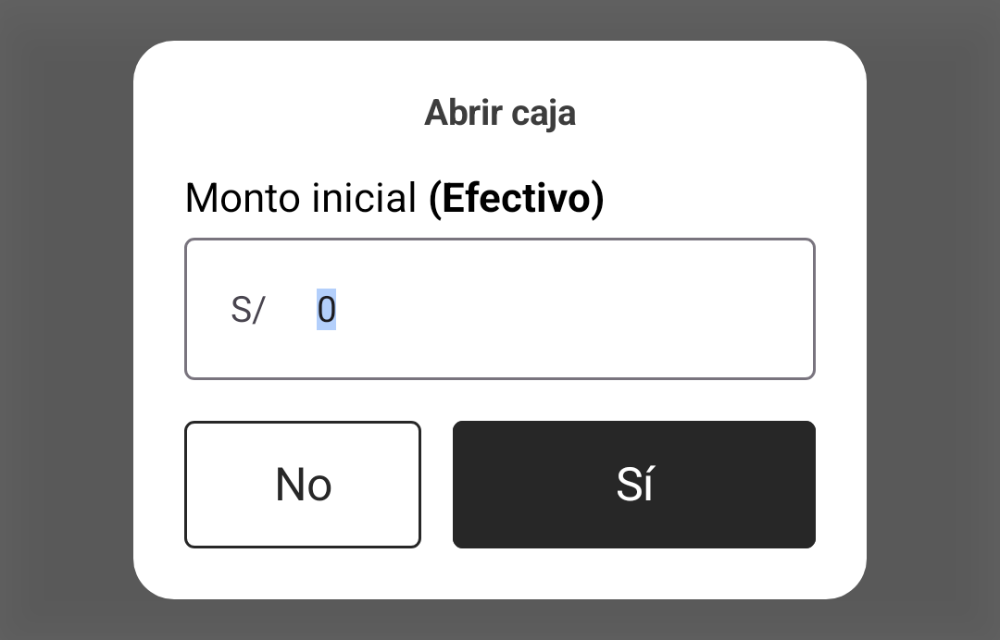

**`OpenSalesBoxDialog`**

```kotlin
OpenSalesBoxDialog(
    title = "Abrir caja",
    inputLabel = "Monto inicial",
    currencyLabel = "Efectivo",
    // readOnlyMessage = "¿Seguro que deseas cerrar la caja?" — modo "solo confirmar", sin campo de monto
    buttonClose = "No",
    buttonSave = "Sí",
    onDismissRequest = { },
    onConfirmation = { monto -> }
)
```

---

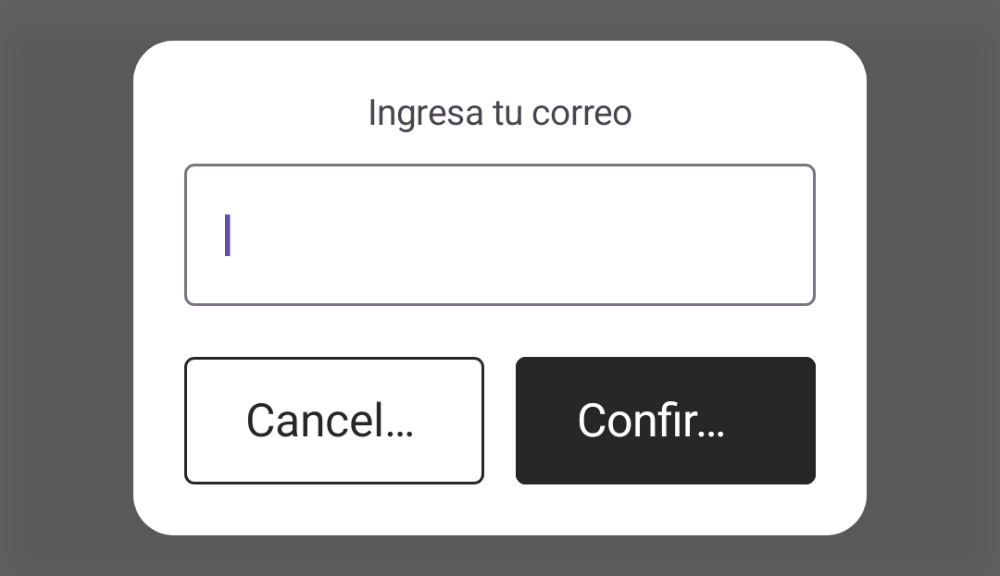

**`SingleTextInputDialog`**

```kotlin
SingleTextInputDialog(
    description = "Ingresa tu correo",
    onDismissRequest = { },
    onConfirmation = { texto -> }
)
```


<sub>⚠️ Antes se llamaba <code>SendEmailDialog</code> — no tenía nada específico de email (ni validación, ni teclado de email), así que se renombró a algo que describe lo que realmente hace.</sub>

---

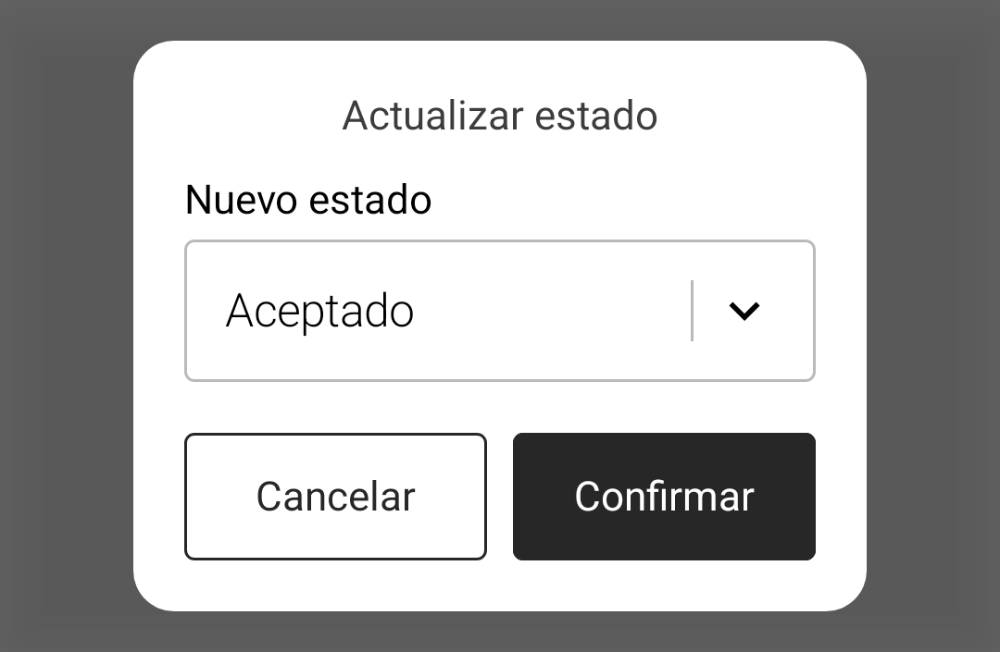

**`StateTypeDialog<T>`**

```kotlin
StateTypeDialog(
    title = "Actualizar estado",
    options = estados,
    label = estadoActual,
    optionLabel = { it.nombre },
    onOptionSelected = { nuevoEstado = it },
    onDismissRequest = { },
    onConfirmation = { /* guardar nuevoEstado */ }
)
```

---

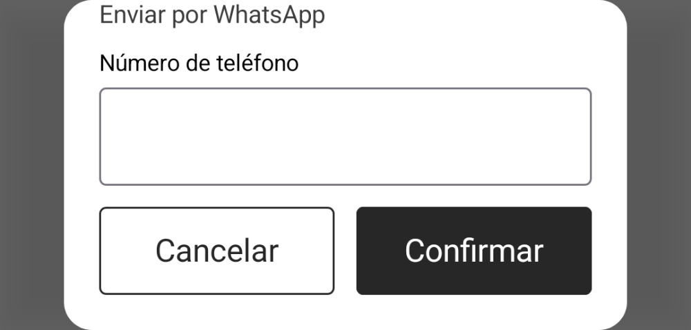

**`PhoneNumberDialog`**

```kotlin
PhoneNumberDialog(
    title = "Enviar por WhatsApp",
    onDismissRequest = { },
    onConfirmation = { numero -> }
)
```


<sub>⚠️ Antes se llamaba <code>WhatsappDialog</code> con 9 dígitos fijos; <code>phoneLength</code> (default 9, como en Perú) ahora es parámetro.</sub>

**No migrados de esta oleada** (evaluados y descartados por ser demasiado
específicos de MypeFact — ver detalle en `MIGRATION_STRATEGY.md`):
`CardDetailsQuotesOrdersList` (hardcodea 7 etiquetas contables), `ReportsDialog`
(5 botones fijos de tipos de reporte PDF), `UbigeoDialog` (selector cascada
departamento/provincia/distrito atado a un ViewModel + entidades de
ubigeo de Perú/SUNAT).

## Build local

```bash
./gradlew :uikit:assembleRelease
./gradlew :uikit:publishToMavenLocal   # valida la publicación sin salir de tu máquina
```

## Publicar en GitHub + JitPack

1. Crear el repo en GitHub (público, o privado si tienes cuenta JitPack Pro)
   y subir este proyecto.
2. Crear un tag de release, por ejemplo `v0.1.0`, y publicarlo en GitHub.
3. JitPack construye el tag automáticamente la primera vez que alguien lo pide
   (puedes forzar el build entrando a `https://jitpack.io/#tu-usuario/mfui-components`).

## Consumir desde otro proyecto

En el `settings.gradle.kts` del proyecto consumidor:

```kotlin
dependencyResolutionManagement {
    repositories {
        // ...
        maven { url = uri("https://jitpack.io") }
    }
}
```

Y en el `build.gradle.kts` del módulo de la app:

```kotlin
dependencies {
    implementation("com.github.tu-usuario:mfui-components:v0.1.0")
}
```
