# mfui-components

Librería de componentes de Jetpack Compose (botones, diálogos, toolbars, etc.),
extraída de MypeFact para poder reusarse entre varios proyectos Android sin
copiar y pegar carpetas.

## Estrategia de migración

Ver [MIGRATION_STRATEGY.md](MIGRATION_STRATEGY.md) para el mapa completo de
qué componentes migrar primero (modo restaurante + entrada de datos), las
reglas de genericidad y el orden de oleadas.

## Estado actual

**Wave 1 completa** (ver `MIGRATION_STRATEGY.md`). Migrados y compilando:

- Tema base: `Color.kt`, `Fonts.kt`, `UiKitTheme.kt`.
- `button/`: `SmallOutlinedButtonMF`, `IconButtonMF`, `SmallIconButton`.
- `items/`: `ItemEmptyList`, `RadioButtonWithBorder`.
- `text_field/`: `TextFieldMF`, `SearchSection`, `EditTextSearch`, `TextFieldDate`,
  `TextFieldDateTime`, `TextFieldMonth`, `TextFieldPlate`, `TextFieldWithCenteredImage`,
  `TextFieldWithButton`, `SwitchMF`, `FieldWidget`, `FieldSearchNumDoc` (rediseñado,
  genérico), `TextFieldCountry`, `TextFieldPhoneNumberByCountry`.
- `select/`: `SelectMF`, `SelectDialogMF`, `SearchDropdownMenu`.
- `country_code_picker/`: las 10 clases completas (selector de país/teléfono,
  ya era un subsistema genérico y autocontenido — solo se le cambió el paquete).
- Soporte: `WidgetCounter`, `dialog/InputTextDialog` (extraído solo la parte
  genérica de `DialogInput.kt`, sin el wrapper atado a `ItemProductsUiState`).

Código muerto detectado y **no migrado a propósito** (cero imports en todo
MypeFact — candidatos a borrar allá): `TextFieldPrefix`, `TextFieldPassword`,
`SelectSmallMF`, `SelectSearchMF`, `CheckboxMF`.

Nuevas dependencias que trajo este wave: `io.michaelrocks:libphonenumber-android`
(validación/formato de teléfono) y `androidx.activity:activity-compose`
(selector de imagen en `TextFieldWithCenteredImage`).

Siguiente parada: **Wave 2** — shell de modo restaurante (`ToolBarMF`,
`LoaderDialog`, `AlertDialog`, `ButtonMF`, `ButtonCountProduct`, etc.).

## Convención de paquetes (para migrar componentes fácil)

El namespace base cambia de `org.mindtec.mypefact` a `org.mindtec.uikit`,
pero la estructura de subpaquetes se mantiene idéntica:

| MypeFact (origen)                          | mfui-components (destino)              |
|---------------------------------------------|------------------------------------------|
| `org.mindtec.mypefact.ui.theme`             | `org.mindtec.uikit.ui.theme`             |
| `org.mindtec.mypefact.ui.components.button` | `org.mindtec.uikit.ui.components.button` |
| `org.mindtec.mypefact.ui.components.dialog` | `org.mindtec.uikit.ui.components.dialog` |
| `org.mindtec.mypefact.utils`                | `org.mindtec.uikit.utils`                |

Para migrar un componente nuevo: copiar el archivo, reemplazar
`org.mindtec.mypefact` por `org.mindtec.uikit` en el `package` y en los
imports, y resolver a mano cualquier dependencia a `R` (recursos del app
host), a `data.*` (entidades propias) o a ViewModels/pantallas de MypeFact.

### Reglas rápidas para desacoplar un componente

1. **`R.string` / `R.drawable` fijos**: la librería puede traer sus propios
   recursos por defecto (`uikit/src/main/res/values/strings.xml`, etc.).
   Un proyecto consumidor puede sobrescribirlos definiendo un recurso con el
   mismo nombre — no hace falta convertir cada texto en parámetro.
2. **Iconos**: en vez de recibir un `Int` (`@DrawableRes`), los componentes
   de este kit reciben un `Painter` ya resuelto por el caller
   (`icon = painterResource(R.drawable.mi_icono)`). Es un cambio de API
   intencional respecto al original: desacopla el componente de
   `painterResource` como implementación fija.
3. **Entidades propias** (`ProductEntity`, etc.): el componente debe recibir
   un modelo/interfaz genérico definido en la librería; cada app mapea su
   propia entidad a ese modelo antes de pasarlo.
4. **ViewModels / navegación / Hilt** (caso `ToolBarHome`): separar en un
   componente genérico (título, ícono, acciones vía lambdas) + la lógica de
   negocio se queda en cada app armando esos callbacks.
5. **Íconos decorativos que NUNCA fueron parámetro en el original** (ej. la
   lupa fija de `EditTextSearch`, la flecha de `SelectMF`): esos SÍ se
   bundlean como recurso propio de la librería (`uikit_ic_*`), no se
   convierten en parámetro nuevo — no era un punto de personalización en el
   diseño original, así que agregarlo sería scope creep. Solo se vuelve
   parámetro (`Painter`, regla 2) un ícono que YA era `Int`/`@DrawableRes`
   configurable en el componente original.

## Ver los componentes renderizados (previews)

Todos los componentes tienen `@Preview` — si abres el proyecto en Android
Studio los ves ahí directamente. Como este flujo también se maneja por CLI,
el módulo `:uikit` además tiene [Paparazzi](https://github.com/cashapp/paparazzi)
configurado, que renderiza los `@Composable` a PNG usando layoutlib sin
necesitar emulador ni dispositivo:

```bash
./gradlew :uikit:recordPaparazziDebug   # genera/actualiza los PNG de referencia
./gradlew :uikit:verifyPaparazziDebug   # compara contra esos PNG (test de regresión visual)
```

Los tests están en `uikit/src/test/kotlin/org/mindtec/uikit/PreviewGalleryTest.kt`
(26 de los componentes migrados hasta ahora, no los 100% — se puede ampliar).
Los PNG quedan en `uikit/src/test/snapshots/images/` y están versionados en git
como referencia visual — el catálogo de abajo los muestra directo.

> **Nota:** el `compileSdk` del módulo está fijado en **35**, no 36. Paparazzi
> 1.3.5 tiene un bug conocido con compileSdk 36
> ([cashapp/paparazzi#1877](https://github.com/cashapp/paparazzi/issues/1877),
> arreglado recién en la rama 2.0.0-alpha, que a su vez no es compatible con
> Kotlin 2.0.0 de este proyecto). Ninguno de los componentes usa APIs
> exclusivas de API 36, así que no hay pérdida real por ahora — si algún día
> se sube el `compileSdk`, revisar si Paparazzi ya lo soporta.

## Catálogo de componentes

Captura real (Paparazzi) + lo mínimo que necesita cada uno para funcionar. Todos viven en `org.mindtec.uikit.ui.components.*` — el import completo es `org.mindtec.uikit.ui.components.<paquete>.<Nombre>`.

### Botones (`ui.components.button`)

<table>
<tr>
<td width="300"></td>
<td>

**`SmallOutlinedButtonMF`**

```kotlin
SmallOutlinedButtonMF(
    text = "Ver todos",
    onClick = { }
)
```

</td>
</tr>
<tr>
<td width="300"></td>
<td>

**`IconButtonMF`**

```kotlin
IconButtonMF(
    text = "Verificar",   // o icon = painterResource(...)
    onClick = { }
)
```

</td>
</tr>
<tr>
<td width="300"></td>
<td>

**`SmallIconButton`**

```kotlin
SmallIconButton(
    icon = painterResource(R.drawable.mi_icono),
    onClick = { }
)
```


<sub>⚠️ <code>icon</code> es obligatorio y es un <code>Painter</code>, no un id de recurso.</sub>
</td>
</tr>
</table>

### Campos de texto (`ui.components.text_field`)

<table>
<tr>
<td width="300">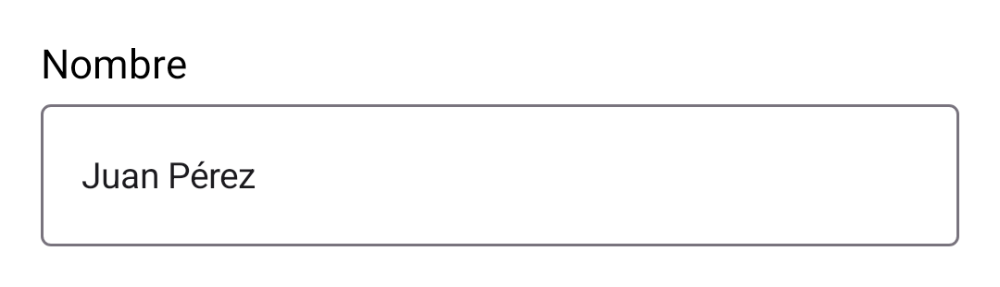</td>
<td>

**`TextFieldMF`**

```kotlin
TextFieldMF(
    title = "Nombre",
    value = nombre,
    onChangeValue = { nombre = it }
)
```

</td>
</tr>
<tr>
<td width="300">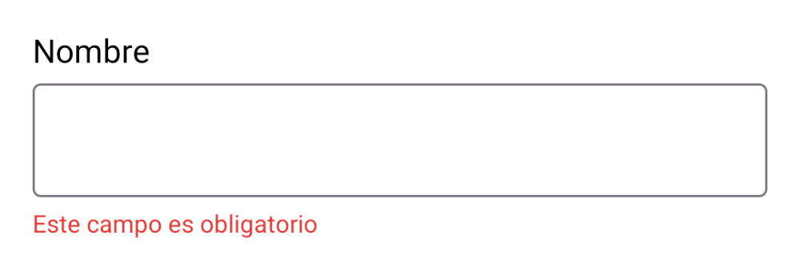</td>
<td>

Mismo componente con `showError = true` (usa el string bundleado
`uikit_field_required_error`, sobrescribible desde tu app).

</td>
</tr>
<tr>
<td width="300">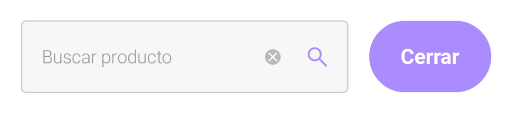</td>
<td>

**`SearchSection`**

```kotlin
SearchSection(
    modifier = Modifier.fillMaxWidth(),
    title = "Buscar producto",
    onSearch = { query -> },
    onClickIcon = { }       // o label = "Cerrar" en vez de icon
)
```

</td>
</tr>
<tr>
<td width="300"></td>
<td>

**`EditTextSearch`**

```kotlin
EditTextSearch(
    title = "Buscar…",
    onSearch = { query -> }
)
```

</td>
</tr>
<tr>
<td width="300">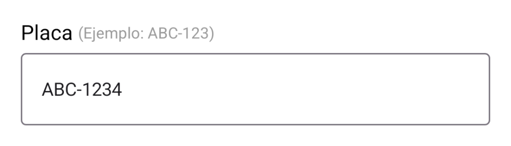</td>
<td>

**`TextFieldPlate`**

```kotlin
TextFieldPlate(
    title = "Placa",
    value = placa,
    onChangeValue = { placa = it }
)
```


<sub>⚠️ Formatea a <code>ABC-123</code> automáticamente al tipear.</sub>
</td>
</tr>
<tr>
<td width="300">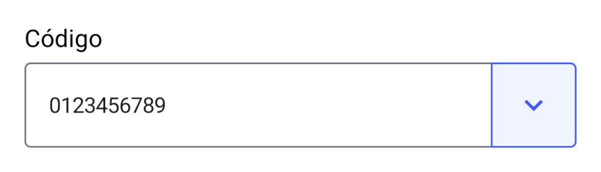</td>
<td>

**`TextFieldWithButton`**

```kotlin
TextFieldWithButton(
    title = "Código",
    icon = painterResource(R.drawable.ic_barcode),
    onChangeValue = { },
    onClickIcon = { }       // ej. abrir el scanner
)
```

</td>
</tr>
<tr>
<td width="300">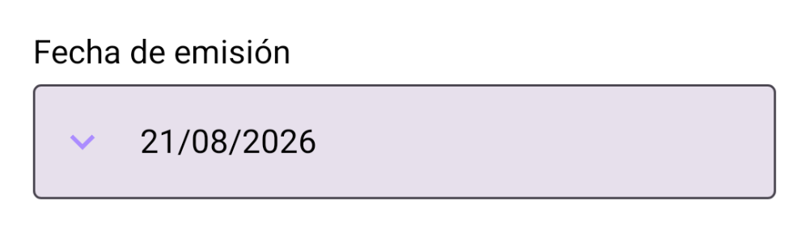</td>
<td>

**`TextFieldDate`**

```kotlin
TextFieldDate(
    title = "Fecha de emisión",
    onChangeValue = { },
    icon = painterResource(R.drawable.ic_calendar),
    enabled = true
)
```

</td>
</tr>
<tr>
<td width="300">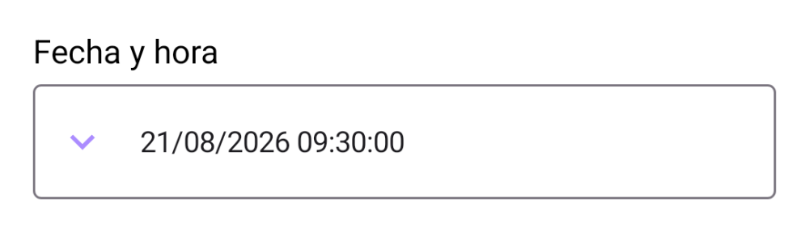</td>
<td>

**`TextFieldDateTime`**

```kotlin
TextFieldDateTime(
    title = "Fecha y hora",
    onChangeValue = { },
    icon = painterResource(R.drawable.ic_calendar),
    enabled = true
)
```

</td>
</tr>
<tr>
<td width="300">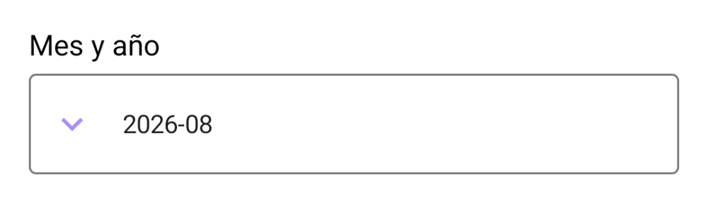</td>
<td>

**`TextFieldMonth`**

```kotlin
TextFieldMonth(
    title = "Mes y año",
    onChangeValue = { },
    icon = painterResource(R.drawable.ic_calendar),
    enabled = true
)
```

</td>
</tr>
<tr>
<td width="300">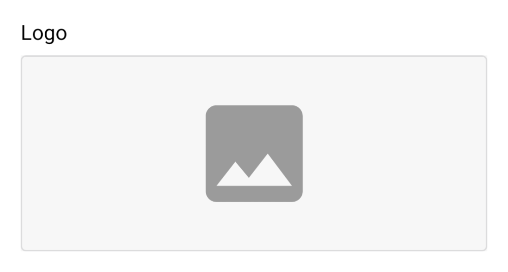</td>
<td>

**`TextFieldWithCenteredImage`**

```kotlin
TextFieldWithCenteredImage(
    title = "Logo",
    imageUri = logoUri,     // null = muestra el placeholder
    onImageSelected = { uri -> }
)
```


<sub>⚠️ Usa <code>rememberLauncherForActivityResult</code> internamente — solo funciona con una <code>Activity</code>/<code>ComponentActivity</code> real detrás (cualquier pantalla normal de la app sirve).</sub>
</td>
</tr>
<tr>
<td width="300"></td>
<td>

**`SwitchMF`**

```kotlin
SwitchMF(
    text = "Notificaciones",
    value = habilitado,
    onCheckedChange = { habilitado = it }
)
```

</td>
</tr>
<tr>
<td width="300">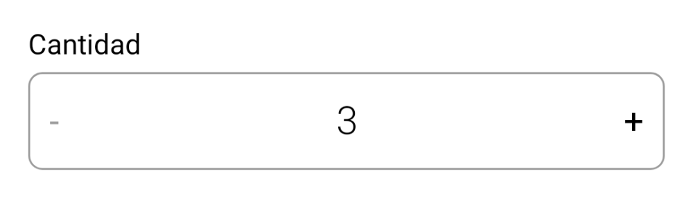</td>
<td>

**`FieldWidget`**

```kotlin
FieldWidget(
    title = "Cantidad",
    quantity = cantidad,
    onClickedMinus = { cantidad = it },
    onClickedPlus = { cantidad = it },
    onConfirmation = { cantidad = it }
)
```


<sub>⚠️ Combina <code>WidgetCounter</code> + <code>dialog/InputTextDialog</code> (ambos incluidos).</sub>
</td>
</tr>
<tr>
<td width="300">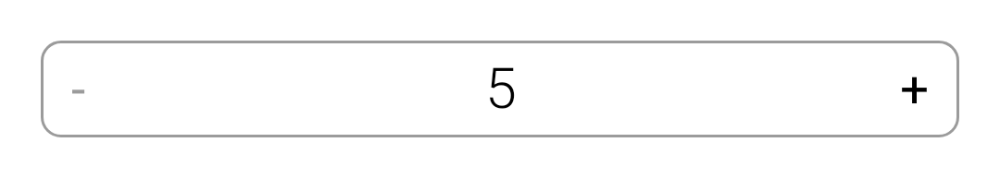</td>
<td>

**`WidgetCounter`**

```kotlin
WidgetCounter(
    quantity = cantidad,
    stock = stockDisponible,
    stockControl = true,
    showInputDialog = { },
    onClickedMinus = { },
    onClickedPlus = { }
)
```


<sub>⚠️ Vive en <code>ui.components</code> (no en <code>text_field</code>) — es la piecita de <code>FieldWidget</code>, úsala suelta si no necesitas el diálogo de cantidad exacta.</sub>
</td>
</tr>
<tr>
<td width="300">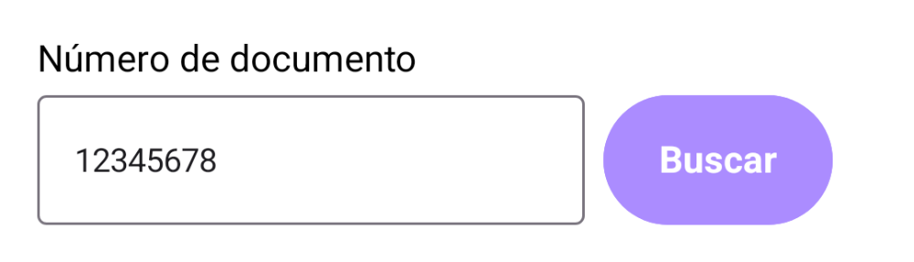</td>
<td>

**`FieldSearchNumDoc`**

```kotlin
FieldSearchNumDoc(
    title = "N° de documento",
    number = numero,
    requiredLength = 8,     // vos decides la longitud (DNI, RUC, etc.)
    onChangeValue = { numero = it },
    action = {
        IconButtonMF(text = "Buscar", onClick = { })
    }
)
```


<sub>⚠️ Rediseñado: el original de MypeFact traía DNI/RUC/SUNAT hardcodeados. Ahora vos armás la validación y el botón vía <code>action</code>.</sub>
</td>
</tr>
<tr>
<td width="300">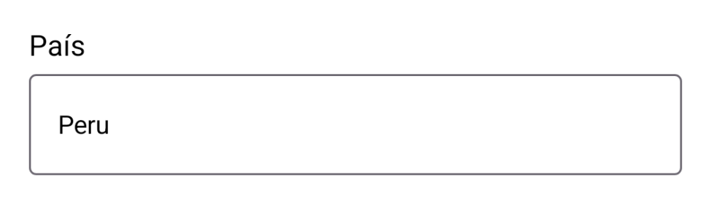</td>
<td>

**`TextFieldCountry`**

```kotlin
TextFieldCountry(
    title = "País",
    onValueChange = { country -> }
)
```


<sub>⚠️ Devuelve un <code>Country</code> de <code>country_code_picker/</code> (ver más abajo).</sub>
</td>
</tr>
<tr>
<td width="300">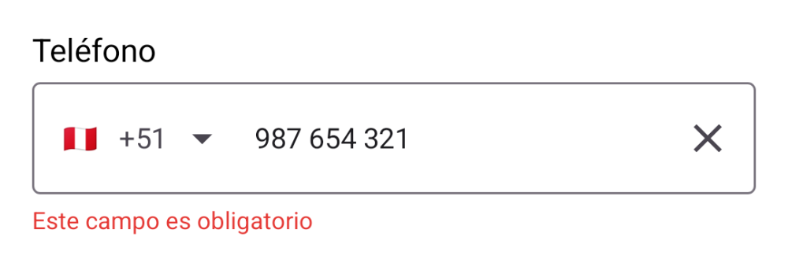</td>
<td>

**`TextFieldPhoneNumberByCountry`**

```kotlin
TextFieldPhoneNumberByCountry(
    title = "Teléfono",
    onValueChange = { (codigo, numero, esValido) -> }
)
```


<sub>⚠️ <code>showError</code> por defecto es <code>true</code> (igual que el original) — pásale tu propia condición de validez.</sub>
</td>
</tr>
</table>

### Selects (`ui.components.select`)

<table>
<tr>
<td width="300">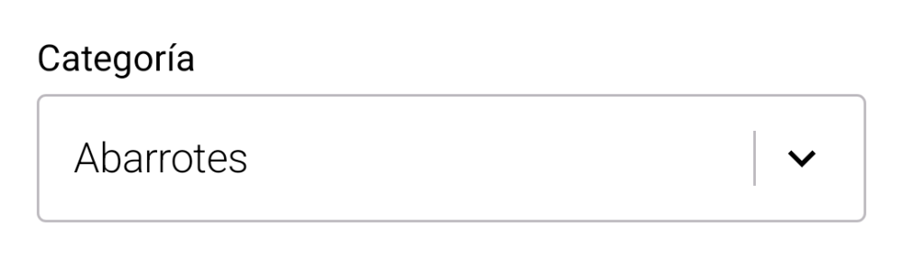</td>
<td>

**`SelectMF<T>`**

```kotlin
SelectMF(
    title = "Categoría",
    options = categorias,
    selectedOption = seleccion?.nombre,
    onOptionSelected = { seleccion = it },
    optionLabel = { it.nombre }
)
```


<sub>⚠️ Con más de 5 <code>options</code> muestra buscador automáticamente.</sub>
</td>
</tr>
<tr>
<td width="300">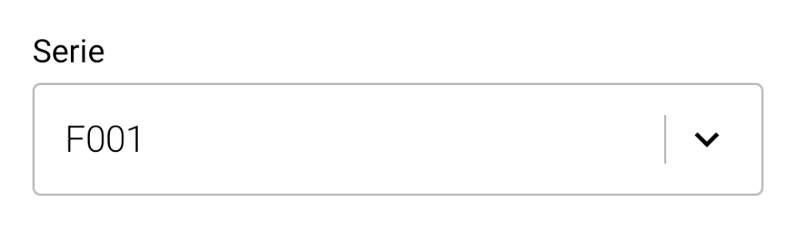</td>
<td>

**`SelectDialogMF`**

```kotlin
SelectDialogMF(
    title = "Serie",
    selectedOption = serie,
    onClick = { mostrarDialogo = true }
)
```


<sub>⚠️ Solo dibuja el campo — el diálogo de selección lo armas vos y lo abres en <code>onClick</code>.</sub>
</td>
</tr>
<tr>
<td width="300">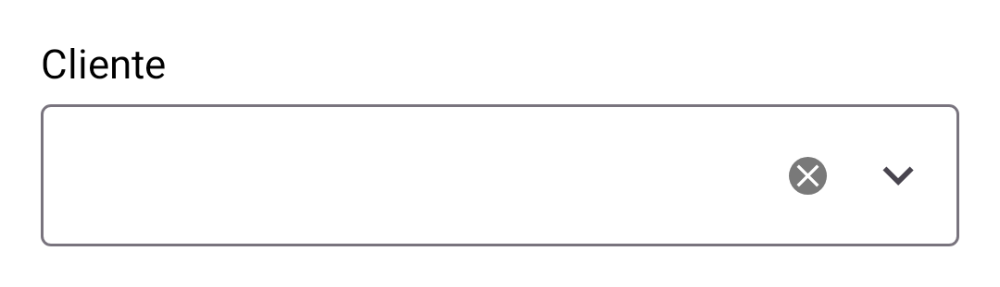</td>
<td>

**`SearchDropdownMenu<T>`**

```kotlin
SearchDropdownMenu(
    title = "Cliente",
    options = clientes,
    filter = { item, texto -> item.nombre.contains(texto, true) },
    optionLabel = { it.nombre },
    optionSelected = { cliente -> }
)
```

</td>
</tr>
</table>

### Items (`ui.components.items`)

<table>
<tr>
<td width="180"></td>
<td>

**`ItemEmptyList`**

```kotlin
ItemEmptyList()   // o ItemEmptyList("Sin resultados")
```

</td>
</tr>
<tr>
<td width="300">
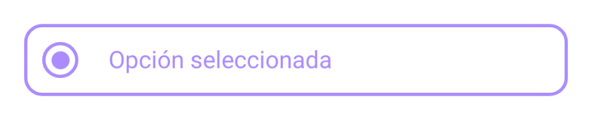<br>
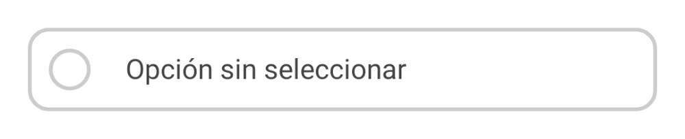
</td>
<td>

**`RadioButtonWithBorder`**

```kotlin
RadioButtonWithBorder(
    isSelected = seleccion == opcion,
    onClick = { seleccion = opcion },
    label = opcion.nombre
)
```

</td>
</tr>
</table>

### Selector de país / teléfono (`ui.components.country_code_picker`)

Subsistema completo de 10 archivos (enum `Country` con ~240 países, validación y formato de números vía `libphonenumber-android`, bottom sheet y diálogo de selección). Ya era genérico en el original — se migró completo y sin cambios de API.

<table>
<tr>
<td width="300"></td>
<td>

**`CountryCodePicker`**

```kotlin
CountryCodePicker(
    selectedCountry = Country.Peru,
    onCountrySelected = { country -> }
)
```


<sub>⚠️ Normalmente no lo usas directo — <code>TextFieldPhoneNumberByCountry</code> ya lo trae integrado como <code>leadingIcon</code>.</sub>
</td>
</tr>
</table>

La dependencia `io.michaelrocks:libphonenumber-android` va como `implementation` dentro de la librería — no hace falta declararla en tu app, ya viaja incluida.

## Build local

```bash
./gradlew :uikit:assembleRelease
./gradlew :uikit:publishToMavenLocal   # valida la publicación sin salir de tu máquina
```

## Publicar en GitHub + JitPack

1. Crear el repo en GitHub (público, o privado si tienes cuenta JitPack Pro)
   y subir este proyecto.
2. Crear un tag de release, por ejemplo `v0.1.0`, y publicarlo en GitHub.
3. JitPack construye el tag automáticamente la primera vez que alguien lo pide
   (puedes forzar el build entrando a `https://jitpack.io/#tu-usuario/mfui-components`).

## Consumir desde otro proyecto

En el `settings.gradle.kts` del proyecto consumidor:

```kotlin
dependencyResolutionManagement {
    repositories {
        // ...
        maven { url = uri("https://jitpack.io") }
    }
}
```

Y en el `build.gradle.kts` del módulo de la app:

```kotlin
dependencies {
    implementation("com.github.tu-usuario:mfui-components:v0.1.0")
}
```
